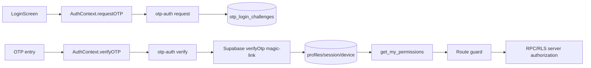
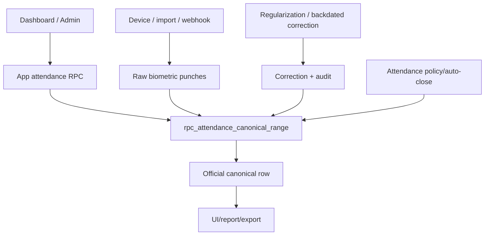
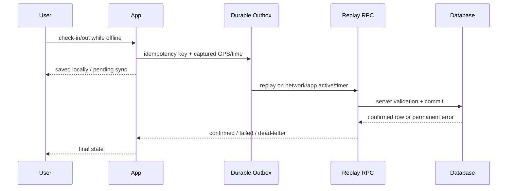
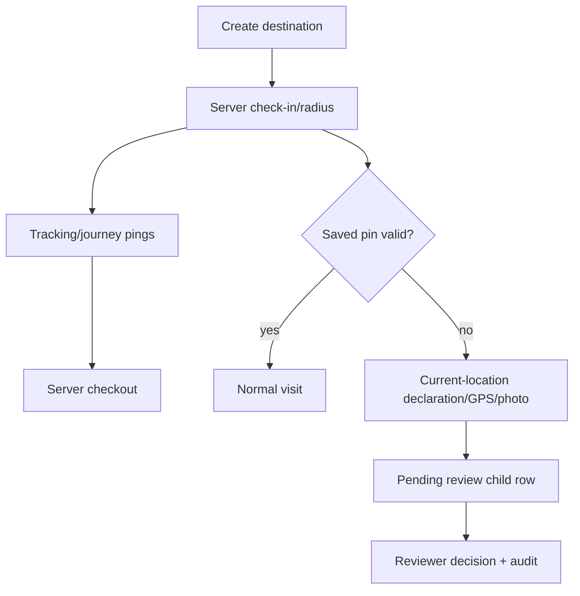
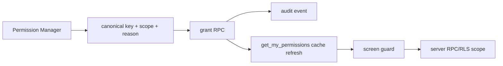
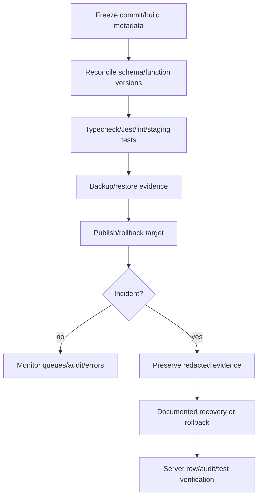

# RealtyHRM — Complete Standard Operating Procedure

**Status:** Expanded repository-audited SOP. Source/deployment gaps are explicitly classified; this document does not certify production readiness.

**Evidence rule:** server RPC responses, deployed database policies and audit records are authoritative. No credentials, tokens, API keys or employee records are included.

## Contents

1. Gap Analysis
2. Employee Mobile Manual
3. Employee Web Manual
4. Hr Panel Manual
5. Team Lead Manual
6. System Admin Manual
7. Attendance Biometric Manual
8. Location Field Visit Manual
9. Technical Database Integrations
10. Deployment Testing Incident Recovery
11. Reports Activity Support Manual
12. Permissions Matrix
13. Workflow Diagrams
14. Test Evidence Register
15. Known Defects Register
16. Source Traceability Matrix
17. Coverage Matrix
18. Audit Reconciliation
19. Scope And Approval Register
20. Sign Off Audit And Action Plan

---

# RealtyHRM SOP Completeness Review — Gap Analysis

> **Historical gap snapshot:** This file records the gaps found in the original baseline. The expanded manuals and control documents in this directory address those documentation gaps where source evidence exists. Current scope decisions, navigation verification and owner approvals are maintained in `19_SCOPE_AND_APPROVAL_REGISTER.md`.

**Review date:** 19 October 2026  
**Compared:** `docs/realtyhrm-sop/*`, `docs/realtyhrm-audit/*`, route/service/source inventory, migrations, Edge Functions and executable tests.

## Result

The existing SOP is a reliable baseline for the core flows, but it is not complete. It describes the main employee attendance, leave, field-visit, permission, notification and deployment concepts; it does not yet provide the requested navigation-level operating instructions or full coverage of the repository.

## Coverage gaps

| Area | Existing baseline | Gap requiring expansion | Classification |
|---|---|---|---|
| Employee mobile | Core sign-in, attendance, leave, field visit and support guidance | Missing exact screens, prerequisites, offline state recovery, activity logs, documents, birthdays, profile, team and notification actions | PARTIALLY DOCUMENTED |
| Employee web | General employee guidance | Missing web-specific routes, PWA/service-worker behavior, foreground-only location, refresh/update recovery and browser permissions | PARTIALLY DOCUMENTED |
| HR panel | High-level review guidance | Missing screen-by-screen navigation, required permission keys, scopes, expected results and escalation for each administrative route | PARTIALLY DOCUMENTED |
| Team Lead | Brief review/task guidance | Missing My Team, hierarchy, task forwarding, team-scoped attendance/leave/field review and escalation operations | PARTIALLY DOCUMENTED |
| System Administrator | Permission and attendance control notes | Missing user lifecycle, device sessions, office/site policies, notification/event configuration, audit, TV display and release controls | PARTIALLY DOCUMENTED |
| Attendance | Online/offline and correction concepts | Missing canonical source reconciliation procedure, policy settings, auto-end, undo, blocked check-in, attempt evidence and reporting | PARTIALLY DOCUMENTED |
| Biometric | High-level import/sync notes | Missing secure sync lifecycle, manual import validation, employee-code matching, duplicate/unmatched handling, webhook and batch recovery | PARTIALLY DOCUMENTED |
| Location/field visits | Core lifecycle and evidence | Missing tracking setup, device health, route/timeline, location-ping requests, In Transit, observer, evidence upload/review, web/native differences | PARTIALLY DOCUMENTED |
| Leave/tasks/events | Basic RPC references | Missing calendars, balance management, task project administration, events/audience/comp-off and approval recovery | PARTIALLY DOCUMENTED |
| Activity/support/feedback | Brief support note | Missing activity classification, analysis, anonymous feedback, ticket status lifecycle and notification failure handling | PARTIALLY DOCUMENTED |
| Reports/exports | Privacy statement only | The baseline lacked report-by-report navigation, date/scope constraints, export verification and download-centre recovery; see the expanded reports manual | BASELINE GAP — EXPANDED |
| Compliance/fraud | Not covered | Suspicious attendance, compliance scores, duplicate devices/sessions and intelligence/exception center | BASELINE GAP — EXPANDED |
| Employee records | Not covered | User management, profile, documents, birthdays, imports and auth revocation | BASELINE GAP — EXPANDED |
| Configuration | Not covered | Office/site policies, predefined sites, weekly offs/holidays, team hierarchy and notification configuration | BASELINE GAP — EXPANDED |
| Technical operations | High-level integration notes | Missing RPC/object map, RLS boundaries, Edge Function contracts, idempotency, queue states and database replacement risks | PARTIALLY DOCUMENTED |
| Testing/release | Pass/fail summary | Missing per-failure error, affected module, likely root cause, verification command and acceptance criterion | PARTIALLY DOCUMENTED |

## Repository modules not sufficiently covered by the baseline

The original baseline inventory identified `DashboardScreen`, `ActivityLoggingScreen`, `MyActivityLogsScreen`, `DocumentsScreen`, `ProfileScreen`, `UpcomingBirthdaysScreen`, `MyTeamScreen`, `HelpSupportScreen`, `ProjectsScreen`, `PayrollScreen`, `SiteVisitApprovalsScreen`, `AdminDashboardScreen`, `AdminDeviceSessionsScreen`, `AttendanceCalendarScreen`, `AttendanceImportScreen`, `BiometricDeviceManagementScreen`, `AttendanceIntelligenceScreen`, `ComplianceScoresScreen`, `DocumentManagementScreen`, `EmployeeBirthdayManagementScreen`, `NotificationManagementScreen`, `OfficeSettingsScreen`, `SiteSettingsScreen`, `SmartOfficeSecureSyncScreen`, `SmartOfficeEmployeeImport`, `SmartOfficeImportedData`, `SuspiciousAttendanceScreen`, `TeamHierarchyScreen`, `TVDisplayScreen`, all dedicated report screens, `services/attendanceIntelligence/*`, `tracking-admin.service.ts`, `transit-warning.service.ts`, `tv-occupancy.ts`, `mailchimp.service.ts`, native bridge/capability/device-health modules and the PWA update path as requiring procedures or an exclusion decision. The expanded set now covers these areas or records an explicit legacy/unmounted exclusion; payroll scope is governed by `19_SCOPE_AND_APPROVAL_REGISTER.md`.

## Evidence gaps that cannot be closed from source alone

1. The applied production migration/function version is not available in the repository.
2. Provider credentials, schedules and live responses for SMS, WhatsApp, SmartOffice, push and Maps are not verified.
3. Android background location, battery, permission revocation and locked-screen behavior require a device test.
4. Backup/PITR, storage recovery and Edge Function rollback evidence is absent.
5. Several historical SQL snapshots define the same RPCs; the live canonical definition must be confirmed before a precedence rule is documented.

## Expansion plan

The expanded manuals in this directory use a consistent procedure template: **navigation → prerequisites → permission → steps → expected result → failure/recovery → escalation → evidence**. The coverage matrix at `16_COVERAGE_MATRIX.md` is the completion gate.


---

# Employee Mobile Application Manual

**Scope:** Android/iOS employee workflow through `MainTabNavigator` and `HomeStackNavigator`. The server determines authorization; this manual does not treat a visible button as permission.

## Common prerequisites

- Active profile and valid OTP session.
- Network for server confirmation; device date/time and location services enabled for attendance/visits.
- Android background location permission is required for reliable locked-screen tracking. iOS/web behavior requires separate verification.

## M-01 Sign in and sign out

**Navigation:** App launch → Login → phone → OTP.  
**Permission:** authenticated profile for all employee operations.

1. Enter the ten-digit Indian mobile number accepted by `LoginScreen` (`^[6-9]\\d{9}$`).
2. Select **Send OTP** and enter the six-digit code.
3. Wait for the authenticated home shell. Do not treat a locally cached profile as an active server session.
4. To sign out, Profile → Sign out. The app closes the device session, deactivates push registration, stops native tracking, clears location/current-visit queues and signs out locally. Pending durable attendance outbox items are not documented as deleted; they remain tied to the employee and require that employee to sign in again for replay/diagnosis.

**Expected:** Home/dashboard loads and the session is persisted through the configured shell-aware storage. Storage protection differs by platform and remains subject to environment/device verification.  
**Failure/recovery:** On expired/invalid OTP, wait for the resend timer and retry once. If the account is inactive or rate-limited, record the message and escalate to HR/System Administrator. The client/server phone-validation mismatch is DB-04; do not bypass it.

## M-02 Dashboard and attendance

**Navigation:** Home → Dashboard.  
**Prerequisite:** location permission, allowed office/site and no unresolved previous operation.

1. Review the displayed attendance state, office/policy prompts, pending sync banner and event cards.
2. Select **Check in**. The app captures GPS, rejects mock location/poor accuracy, resolves the nearest allowed office and calls the server check-in RPC.
3. Continue only when a committed server timestamp/status is shown. Start tracking only after the server confirms attendance.
4. Select **Check out** at the end of work. Confirm the server returns `checkout_time`; do not rely on a toast alone.
5. If offline, confirm the explicit offline prompt. The action is stored in the durable outbox with the captured time and idempotency key. Reconnect and wait for **confirmed/synced** status.

**Failure/recovery:**

- Outside radius or mock GPS: move to the allowed location, disable mock location and retry; repeated blocks go to HR with the check-in attempt ID.
- Network loss: keep the device online, open the app and wait for outbox drain; do not submit duplicate actions.
- Unknown/failed sync: capture the outbox/dead-letter message and escalate to Technical Operations.

**Evidence:** `DashboardScreen.tsx`, `services/attendance.service.ts`, `services/offline-attendance.service.ts`, `services/outbox/DurableWriteOutbox.ts`.

## M-03 Attendance history and correction request

**Navigation:** Home → Attendance & Regularization.  
**Permission:** own attendance operations; review permission is server-scoped.

1. Filter the required business month/date.
2. Review app/biometric/canonical status and any checkout reason.
3. Use regularization only for `EARLY_CHECKOUT` or `MISSED_CHECKOUT`.
4. For a missing check-in, past date or HR-entered correction, open the Backdated workflow through HR; do not submit a regularization request for the wrong type.
5. Track the returned request status and review notes.

**Expected:** request ID/status is returned and the history refreshes from the server.  
**Failure/recovery:** If a duplicate/open request exists, use the existing request; if the date is outside policy, escalate with the business date and server error.

## M-04 Leave

**Navigation:** Home → Leave History → Apply Leave.  
**Permission:** authenticated employee; approval is a reviewer permission.

1. Review balance and calendar/weekly-off information.
2. Choose sick, casual, earned, WFH or comp-off; enter start/end dates, reason and half-day period where applicable.
3. Submit and confirm `rpc_submit_leave_request` returns success and request ID.
4. Use the request detail to cancel only when the server permits cancellation.

**Failure/recovery:** Invalid dates, overlap, insufficient balance or closed status must be recorded exactly. Do not edit `leave_requests` directly; escalate to HR for policy/balance correction.

## M-05 Field visits and location

**Navigation:** Home → Field Visits.  
**Prerequisite:** destination coordinates, location permission and (for evidence) camera/gallery permission.

1. Select **Log Where I’m Going/Add Next Stop**.
2. Choose a saved site, map pin or valid destination; confirm purpose/contact/project details.
3. Select **Check in** only at the destination and wait for `CHECKED_IN` with server time.
4. Record notes/evidence if requested, then select **Check out** and wait for `COMPLETED`.
5. If the saved pin is wrong/outside radius, use current-location submission with a reason and declaration; do not create a duplicate visit.

**Expected:** one visible visit card; verification child rows are collapsed in the employee view.  
**Failure/recovery:** pending upload → retry queue; rejected/needs-information → follow reviewer notes; web/locked-screen limitation → use Android app or report tracking gap.

## M-06 Activity logging

**Navigation:** Home → Log Activity; history → My Activity Logs.  
**Prerequisite:** valid location/details appropriate to the activity.

1. Choose office/site/meeting/other, enter location, destination, notes and meeting details.
2. Submit; the client classifies activity and stores confidence/billable/quality fields in `activity_logs`.
3. Review or correct own history; do not fabricate GPS or client details.

**Failure/recovery:** low-quality classification is a flag, not an approval. Retry network failures and escalate persistent RLS/insert errors with timestamp and error code.

## M-07 Tasks, team, notifications and support

- **Tasks:** Tasks tab → review assigned/created/shared tasks; update only when the server returns `can_update`; forwarding is only to direct reports via the server.
- **My Team:** Home → My Team when the tab is available; review reports/team data within scope.
- **Notifications:** Home → Notifications; mark/read from the notification list. Missing push delivery is diagnosed through the notification/outbox procedure, not by repeatedly refreshing.
- **Support:** Home → Raise Ticket or Profile → Help & Support; submit category, priority, title and description. Ticket persistence is authoritative; WhatsApp is best-effort.
- **Birthdays/Profile:** Profile → profile details/help; Birthdays is opened from Home → Birthdays. `DocumentsScreen` is present in the repository but is not registered in the active navigators, so it is not an approved employee workflow until product/runtime activation is confirmed.

## M-08 Employee escalation template

Provide user ID (not OTP), business date/time with timezone, screen path, request/idempotency ID, exact error, network state, device/OS and whether the server-confirmed record exists. Remove employee GPS trails, tokens and personal data from screenshots.


---

# Employee Web/PWA Manual

**Navigation:** Browser → configured HRMS web path → Login → Home/Tasks/Profile. `RootNavigator`, `MainTabNavigator`, web route/deep-link handling and service-worker code determine the shell.

## W-01 Browser prerequisites

- Use a supported browser with JavaScript, notifications and location enabled.
- Keep the HRMS tab active during web tracking; browser background/locked-screen tracking is not equivalent to Android native tracking.
- Permit storage/service-worker registration unless corporate policy blocks it. If registration fails, the app can continue online-only but update/offline behavior is reduced.

## W-02 Login and web session

Follow the mobile OTP steps. The browser stores the Supabase session through the configured shell-aware persistent storage; browser storage protection is environment-dependent and is not certified as secure storage by source inspection alone. If the Android shell bridge is available, `NativeShellConnector` synchronizes session/tracking/notifications; never copy tokens manually.

**Failure/recovery:** clear only the HRMS site data after documenting the error; sign in again. If the web path redirects incorrectly, record the configured base path and deep link; do not alter hosting files during incident handling.

## W-03 Web attendance

1. Home → Dashboard.
2. Allow browser location and select Check in/out.
3. Keep the page active until the server-confirmed result appears.
4. If offline, treat local saved state as pending only; reconnect and wait for durable outbox confirmation.

**Expected:** attendance row/server timestamp appears.  
**Limitation:** no reliable locked-screen/background location tracking on web (LT-01). For field work that requires continuous arrival/departure tracking, use the Android app.

## W-04 Web field visits and maps

Use Home → Field Visits. Map pins, navigation links and geofence checks use browser-capable services. Google Maps/Directions configuration is an external dependency; a broken map key or blocked API must be escalated as configuration, not worked around by changing coordinates.

## W-05 Web updates and stale shell recovery

1. If a release banner says an update is ready, save any pending work and reload through the banner.
2. If the shell is stale, open browser developer/application storage, inspect the HRMS service worker/cache status, then perform a controlled reload. Do not delete unrelated site data.
3. Recheck build ID/schema banner and sign-in after reload.

**Escalate:** hosting/deploy owner for service-worker mismatch, release metadata mismatch or repeated cache rollback. Evidence: browser console message, build ID, configured web path and whether a fresh private window reproduces it.


---

# HR Panel Manual

**Entry:** Main tab → HR Panel → Admin Dashboard.  
**Authorization:** `usePermissions.canOpenScreen()` is only a client gate. The corresponding server permission/RLS/RPC check is authoritative. HR/HRD are data-admin roles in the client catalog but permission-management rights remain restricted.

## HR-01 Common review procedure

1. Record employee/date/scope before opening a queue.
2. Confirm the route is present and not a legacy screen.
3. Filter narrowly; review source/evidence/audit fields.
4. Use the screen action/RPC and wait for a confirmed response.
5. Refresh from the server and retain request ID/status/notes.

If a screen is visible but the RPC returns `PERMISSION_DENIED`, stop and escalate to the System Administrator; never bypass with a direct table edit.

## HR-02 Employee and records

**Navigation:** HR Panel → User Management; Employee Birthday Management. `DocumentManagementScreen` exists in source but is not registered in the active admin navigator; do not treat it as an available HR workflow without route/runtime activation evidence.  
**Permission:** `employees.view`/`employees.manage`, `birthdays.manage`; server scope.

- Search by employee number/name, review active status/role/office/team.
- Create/edit/deactivate only with validated profile data and reason.
- Assigning platform administrator roles is a higher-risk server-controlled action.
- Review birthday/document changes through audit; do not download or circulate unnecessary personal data.

**Failure/recovery:** duplicate phone/employee number or invalid lifecycle status → correct the source data and retry; unauthorized role assignment → System Administrator.

## HR-03 Attendance Control and review queues

**Navigation:** HR Panel → Attendance Control, Attendance Regularization, Backdated Attendance, Attendance Calendar, Check-In Logs, Suspicious Attendance, Compliance Scores.  
**Permissions:** `attendance.view`, `attendance.regularize`, `regularization.view/approve`, `attendance.backdate_correct/approve`, `attendance.calendar.manage`, `checkin_logs.view`, `suspicious.view`, `employees.view`.

1. In Attendance Control select business date/range and App or Biometric tab.
2. Review canonical/server fields, raw device logs, reconciliation state and audit evidence.
3. For direct correction, select an existing attendance record, enter a reason and valid IST times, then confirm the audited RPC result. If no record exists, route to Backdated Attendance.
4. In Attendance Regularization, filter PENDING/APPROVED/REJECTED, inspect the employee reason and canonical first/last times, then approve/reject with notes.
5. In Backdated Attendance, use the correct origin (employee request or HR entry), evidence/reason code and verification state. High-risk approvals require the server’s second-person controls where deployed.
6. Use Check-In Logs for blocked/outside-office attempts, Suspicious Attendance for fraud/GPS evidence and Compliance Scores for the summarized score—not as a replacement for source records.

**Expected:** server status changes, audit event and refreshed canonical/report output.  
**Recovery:** stale page → refresh canonical data; conflicting sources → escalate with record IDs; RPC missing/schema mismatch → database owner.

## HR-04 Leave and calendar

**Navigation:** HR Panel → Leave Management, Leave Balance, Attendance Calendar.  
**Permissions:** `leave.view`, `leave.approve`, `leave.balance.manage`, `attendance.calendar.manage`.

- Review pending leave, overlap/balance and approval scope.
- Approve/reject through the server review action with notes.
- Adjust balance only with reason and audit confirmation.
- Maintain holidays/weekly-off rules only after validating office/user scope.

## HR-05 Work, communication and feedback

**Navigation:** Tasks & Projects, Notification Management, Ticket Management, Event Management, Anonymous Feedback, Team Hierarchy, TV Display.  
**Permissions:** `tasks.view/manage`, `notifications.send`, `tickets.manage`, `events.manage`, `feedback.view`, `teams.manage`, `attendance.view` for TV display.

- Assign tasks only to permitted scope; use hierarchy-aware results.
- Send notifications after checking audience, message and delivery channel; inspect outbox after dispatch.
- Resolve tickets with resolution notes; ticket row is authoritative if WhatsApp fails.
- Create events with audience, venue/radius, date/time and comp-off settings; event attendance is separate from ordinary attendance.
- Read anonymous feedback without attempting re-identification.
- TV Display is a read-only operational display; verify date/office scope before placing on a shared screen.

## HR-06 Field and monitoring

**Navigation:** Field Visits, Site Visit Observer, Live Tracking, In Transit, Activity Analysis.  
**Permissions:** `field_visits.view`, `live_tracking.view`, `activity_analysis.view`.

Review only the authorized scope, check freshness/signal status, distinguish live from historical data and avoid exporting unnecessary GPS history. For current-location submissions, record decision/notes through review RPC and preserve audit history.

## HR-07 Reporting

Open Reports tab and select the guarded report. Filter by date, office/team/employee only when the server permits. Confirm export/download completion and store files in approved access-controlled locations. Report-specific procedures are in the technical/report manual and matrix.


---

# Team Lead Operations Manual

Team Lead operations are not granted solely by a label such as `TEAM_LEADER`, `SALES_MANAGER` or `BUSINESS_HEAD`. Team visibility and actions depend on reporting hierarchy plus active scoped permissions returned by `get_my_permissions` and enforced by server RPC/RLS.

## TL-01 Open team workspace

**Navigation:** Main tab → My Team (when rendered) or Tasks → team-related action.  
**Prerequisites:** active direct reports or escalation visibility; current session.

1. Confirm team members and reporting lines shown by the server.
2. Select an employee only within the returned scope.
3. Use the specific action (task, leave, attendance, field visit) rather than assuming all team data is editable.

**Failure/recovery:** My Team tab absent means no current team/escalation visibility; request hierarchy correction from HR. `PERMISSION_DENIED` requires permission review, not a client-side workaround.

## TL-02 Task assignment and forwarding

**Navigation:** Tasks tab → task detail → Forward/Update; HR Panel → Tasks & Projects if granted.  
**Permission:** `tasks.view`/`tasks.manage` or server relation flags.

1. Load `rpc_my_tasks` and inspect `relation`, `can_update`, `can_forward` and `forwarded_count`.
2. Update only when `can_update` is true.
3. Use **Forward** to direct reports; select individuals or all direct reports as allowed.
4. Confirm `rpc_task_forward` returns success/added count, then refresh the task list.

**Recovery:** `NOT_YOUR_TEAM`, `NO_DIRECT_REPORTS` or `FORBIDDEN` → check hierarchy and scope with HR/Admin; do not insert task shares directly.

## TL-03 Team attendance and regularization

**Navigation:** permitted HR Panel Attendance Control/Regularization or Reports tab.  
**Permission:** scoped `attendance.view`, `regularization.view/approve`, `attendance.regularize`.

1. Filter to the team/date returned by server scope.
2. Compare canonical official first-in/last-out with app, biometric and approved corrections.
3. Review early/missed checkout regularization only; route missing check-in/backdated cases to Backdated Attendance.
4. Approve/reject with an evidence-based note; verify audit/canonical refresh.

## TL-04 Team leave and field activity

Use Leave Management or Reports only if `leave.view/approve` is granted. Review leave balance, overlap and reason before decision. For field visits, use Field Visit Admin/Observer and verify GPS freshness, mismatch status, evidence and reviewer status. Never publish a PENDING or FLAGGED visit as verified.

## TL-05 Team communication and escalation

Use task/notification/event channels for operational messages. For a system issue, provide scope, employee ID, date/time, request ID and exact RPC/error. Escalate:

- hierarchy/role issue → HR/System Administrator;
- attendance source conflict → Attendance Administrator/database owner;
- location/device issue → Technical Operations;
- missing notification → notification/outbox owner.


---

# System Administrator Manual

**Role model:** `SYSTEM_ADMIN` and `SUPER_ADMIN` aliases are normalized to `SYSTEM_ADMIN`. `ADMIN` is also a permission administrator by the catalog. `HR`/`HRD` are data-admin roles but are not automatically permission administrators.

## SA-01 Permission administration

**Navigation:** HR Panel → Permissions Manager → People / Role Templates / Simulator / History.  
**Permission:** `permissions.view`, `permissions.assign`, `permissions.revoke`; server `hrms_is_permission_admin`/grant/revoke RPCs.

1. Search and verify the target profile and current grants.
2. Choose canonical permission, scope (`GLOBAL`, `OFFICE`, `OFFICE_TREE`, `TEAM`, `TEAM_TREE`, `REPORTS_TO`, `ASSIGNED`, `SELF`, `DEPARTMENT`) and expiry where applicable.
3. Enter a meaningful reason for high-risk grants.
4. Confirm the RPC response, audit event and refreshed permission cache.
5. Simulate access before asking the user to retry.

**Safety:** no self-grant by delegated administrators; never copy tokens or use a direct table edit. A grant can make a screen visible while a separate RPC/RLS check still denies data.

## SA-02 User lifecycle and auth revocation

**Navigation:** HR Panel → User Management; Device Sessions.  
**Permission:** `employees.view/manage`, `devices.manage`; auth revocation is server-controlled.

1. Validate identity, employee number, phone, role, office, team, reports-to and active/lifecycle state.
2. For deactivation/exit, use the lifecycle action and retain reason/date.
3. For duplicate/compromised sessions, inspect Device Sessions and revoke the selected auth/device session; confirm audit and user sign-out.
4. Verify the user no longer receives active scoped permissions or push registration as intended.

## SA-03 Office, site and attendance policy configuration

**Navigation:** HR Panel → Offices & Settings; Sites & Geofences; Attendance Calendar.  
**Permission:** `offices.manage`, `sites.manage`, `attendance.calendar.manage`.

1. Review office coordinates, radius, timezone/policy and active state.
2. Maintain predefined sites/geofences with valid coordinates and radius.
3. Configure holidays/weekly offs with correct office/user scope.
4. Change attendance policy through the admin mutation/RPC path, with reason and audit confirmation.
5. Test one check-in/checkout in staging after changes; do not assume UI save means active production policy.

## SA-04 Events, notifications, tickets and feedback

Use Event Management, Notification Management, Ticket Management and Anonymous Feedback only within their catalog permissions. Verify audience, content and outbox/delivery status. Preserve anonymous feedback anonymity and avoid joining it with user-identifying data.

## SA-05 Data integrity and audit

Use Audit Logs, canonical attendance views/RPCs, biometric batch/request status and location/field audit tables for investigation. Never repair attendance, GPS evidence or permission rows with an ad-hoc SQL update; create an approved migration/RPC change under separate authorization.

## SA-06 Release control

Before release, reconcile `release.config.json` required schema/Edge versions with the applied migration/function set, run all required checks, confirm backups/restore test and stage rollback. Current repository blockers are recorded in `13_TEST_EVIDENCE_REGISTER.md` and `14_KNOWN_DEFECTS_REGISTER.md`.


---

# Attendance and Biometric Administration Manual

## Authority model

The official day is obtained through the business-clock/IST path. `CanonicalAttendanceService` calls `rpc_attendance_canonical_range` with a view fallback. The repository contains historical replacement definitions; never publish a fixed app-versus-biometric precedence until the deployed RPC is verified.

## AB-01 Configure attendance policy

**Navigation:** HR Panel → Offices & Settings → Attendance policy.  
**Permission:** `offices.manage`; server configuration mutation.

1. Review allowed office/radius, minimum work duration, earliest checkout, auto-close/night-shift settings and reminder flags.
2. Enter the change through the policy RPC with reason.
3. Confirm returned policy and audit event.
4. Test on staging with a controlled employee/date.

**Failure:** policy save succeeds in UI but check-in behavior is unchanged → verify deployed migration/function and policy cache, then escalate to database owner.

## AB-02 Canonical reconciliation

**Navigation:** HR Panel → Attendance Control or Reports → Attendance/Advanced/Attendance Register.  
**Permission:** scoped `attendance.view`/`attendance.export`.

1. Select IST business date/range and scope.
2. Read canonical rows: official first-in, official last-out, attendance status, source labels, warnings, app/biometric evidence and correction state.
3. Open raw app attendance, device punches, regularization/correction and audit events for discrepancies.
4. Record the canonical RPC/view response and do not infer precedence from historical SQL files.

## AB-03 Online and offline attendance

Employee action → `AttendanceService` → protected check-in/out RPC → attendance/audit tables → canonical response → UI state.

- Check-in validates mock GPS, accuracy, office radius, idempotency and committed timestamp.
- Check-out validates policy/early reason and committed timestamp; undo uses the dedicated undo RPC within server limits.
- Offline check-in/out uses cached offices, captured GPS/time, a durable outbox and replay RPCs; the phone state is not confirmation.

**Recovery:** inspect outbox state, retry/backoff/dead-letter, server response and duplicate operation ID. Do not replay manually with a new ID unless Technical Operations directs it.

## AB-04 Regularization and backdated correction

**Regularization:** only `EARLY_CHECKOUT` and `MISSED_CHECKOUT`; list through admin RPC, review with approve/reject notes.  
**Backdated:** employee/HR correction with reason/evidence/origin, date-window checks, no full-day approved leave conflict where deployed, one open request per employee/day and permanent correction/audit events.

1. Search employee/date.
2. Preview canonical/current state.
3. Submit or review with reason code, time/evidence and idempotency key.
4. For high-risk correction, require second-person approval if the deployed function requires it.
5. Refresh canonical result and audit log.

## AB-05 Biometric secure sync

**Navigation:** HR Panel → SmartOffice Integration/Secure Sync.  
**Permission:** `biometric.manage`.

1. Choose date range and start protected sync with a unique request ID.
2. Poll request/batch status; do not start a second request while the previous state is UNKNOWN/IN_PROGRESS.
3. Confirm transaction status, submitted/inserted/duplicate/rejected counts and batch/source hash.
4. Reconcile device punches to employee identity and canonical attendance.

**Edge Functions:** `biometric-attendance-sync`, `smartoffice-proxy`; database objects include `biometric_sync_requests`, import batches/state and ingest/apply RPCs. Provider credentials/schedules are unverified.

## AB-06 Manual biometric import and matching

**Navigation:** HR Panel → Employee Import → Imported Data → Biometric User Match.  
**Permission:** `biometric.manage`, with `employees.manage` for identity mapping.

1. Upload the source file in the supported format.
2. Parse dates/times; reject invalid date/time rows and future/today rows where the service protects live sessions.
3. Match only by unique SmartOffice employee code; unresolved/duplicate/blank codes remain unmatched.
4. Review matched rows and source file hash; explicitly click Import.
5. Confirm committed response counts: submitted = inserted + duplicates + rejected; record batch ID and errors.

**Recovery:** fix code mapping in Biometric User Match, create a new validated batch, and never overwrite live attendance through a manual import.

## AB-07 Webhook and device operations

`biometric-punch-webhook` requires its configured webhook secret and ingests punch payloads; `BiometricDeviceManagementScreen`/SmartOffice screens expose device/configuration controls where routed. A webhook HTTP success is not a canonical attendance result; verify raw punch, mapping, batch and canonical records.


---

# Location Tracking and Field Visit Manual

## LT-01 Tracking setup and health

**Navigation:** Home → Location Tracking Setup; employee Dashboard/Field Visits; admin → Live Tracking/In Transit/Site Visit Observer.  
**Permissions:** employee owns own tracking; admin `live_tracking.view`, `field_visits.view`, `activity_analysis.view` as applicable.

1. Check device capability and location permission.
2. On Android, allow background location and battery-unrestricted operation if company policy permits.
3. Confirm active attendance/field-visit destination before expecting tracking.
4. Review tracking health, last ping age, accuracy, battery and signal state.
5. Stop/restore through the app lifecycle controls; do not kill the process while diagnosing.

**Platform result:** native task `hrms-attendance-location-v2` supports background behavior; web/PWA is foreground-only. Actual Android permission/battery behavior remains UNVERIFIED until device acceptance testing.

## LT-02 Location ping lifecycle

Native/web collector → quality/mock checks → offline secure queue if needed → `record_location_ping` → `location_tracking`/`journey_events` → journey/geofence event → notification outbox/dispatch.

The database migration intentionally has no direct insert policy for location tables. A missing row must be diagnosed through RPC response, queue state, tracking session and server stop conditions (no open attendance/visit, closed session or stale >16 hours).

## LT-03 Create and manage field visit

**Navigation:** Home → Field Visits → Log Where I’m Going.  
**Prerequisite:** valid destination coordinates; selected site if using predefined site.

1. Enter visit type, location, address, meeting/contact/project details and notes.
2. Confirm map pin/radius and submit. The service derives origin from latest ping or attendance check-in and calls `rpc_mutate_own_field_visit(CREATE)`.
3. At site, select Check in; server returns `CHECKED_IN` and time.
4. Use navigation/Active Journey and allow tracking while en route/at site.
5. Add checkout notes/evidence if required and select Check out; server must return `COMPLETED` and time.
6. Mark missed only when the visit was not completed and server permits it.

## LT-04 Selected-site and mismatch workflow

Selected-site check-in calls `check_in_field_visit_at_selected_site` and computes distance server-side. If the saved pin is wrong/outside radius:

1. Open current-location submission from the visit.
2. Select actual location/site, enter mismatch reason, purpose, expected duration and declaration.
3. Capture GPS and evidence photo when required; use idempotency key.
4. Submit through `submit_field_visit_current_location_v2` and wait for `PENDING` verification.
5. Reviewer uses `review_field_visit_current_location` and records APPROVED/REJECTED/NEEDS_INFORMATION/FLAGGED with notes.

Do not delete/rewrite the original visit. The child/source relationship is protected and employee UI collapse is only a display behavior.

## LT-05 Evidence upload/retry

`field-visit-evidence-upload` handles the upload boundary; storage bucket/path ownership and image constraints are enforced by SQL/policies. If upload is queued, use the retry queue, confirm object path and server submission response, and avoid duplicate photos. A `PENDING` row is not approval.

## LT-06 Admin monitoring

- **Live Tracking:** inspect current scope, freshness/signal status, last ping and visit state; distinguish LIVE, DELAYED, SIGNAL_LOST and historical.
- **In Transit:** inspect journey origin/destination, route/progress and warning status; do not interpret navigation distance as attendance proof.
- **Site Visit Observer:** review employee/visit cards, current location, signal and verification; preserve privacy and scope.
- **Field Visit Admin:** review daily visits and evidence; use server review actions.
- **Reports → Geofence Events/Field Visits/Tracking:** record date/scope/export and verify output.

## LT-07 Troubleshooting

| Symptom | Diagnostic evidence | Likely cause | Corrective action | Verification |
|---|---|---|---|---|
| No ping | permission state, tracking session, queue, last ping | permission revoked, stopped session, offline | restore permissions/tracking; drain queue | new `location_tracking` row |
| Stale signal | `recorded_at`, accuracy, battery, app state | foreground/web limitation or battery restriction | keep page active/use Android; allow background | fresh ping age |
| Visit cannot check in | GPS accuracy/mock/distance/RPC error | outside radius or invalid coordinates | move/repair site pin/current-location request | `CHECKED_IN` server response |
| Evidence pending | storage object, upload response, review status | queue or reviewer backlog | retry/upload or contact reviewer | status + audit event |


---

# Technical Operations, Database and Integrations Manual

## T-01 Runtime architecture

`App.tsx` composes ErrorBoundary → AuthProvider → LocationTrackingProvider → durable outbox/push/offline evidence/web tracker → navigation. Supabase is accessed through `lib/supabase.ts` using Auth, PostgREST, RPC, Realtime and Storage. Edge Functions provide OTP, biometrics, SmartOffice, evidence, notifications, auto-end and auth revocation.

## T-02 Database change control

1. Identify the migration file and all later `CREATE OR REPLACE`/`DROP` definitions for the object.
2. Compare function signature, `SECURITY DEFINER`, `search_path`, grants/revokes, RLS/policies, triggers and dependent views.
3. Confirm the migration is applied in the target environment; filenames alone are insufficient.
4. Run read-only schema/object checks in staging, then an approved migration with rollback plan.
5. Record migration ID, object signature, deployment timestamp and verification query.

Historical/combined SQL under `_superseded`, `manual`, `_temp`, root scripts and generated reports is evidence only until deployment provenance is established.

## T-03 Object/domain map

| Domain | Primary objects | Write boundary |
|---|---|---|
| Identity | `profiles`, auth users, device sessions, push tokens | OTP/auth/session RPCs and Edge Functions |
| Attendance | `attendance_logs`, device/biometric logs, canonical views/RPCs, audit/correction tables | attendance, correction, import and canonical RPCs |
| Location | `tracking_sessions`, `location_tracking`, `journey_events`, `field_visits`, audit tables | `record_location_ping`, field-visit RPCs, evidence functions |
| Leave/work | leave requests/balances/calendar, tasks/hierarchy, events | leave/task/event RPCs and scoped table policies |
| Communication | notifications/outboxes/delivery logs, support tickets, feedback | notification enqueue/dispatch, ticket writes, review RPCs |
| Authorization | permission catalog/grants, scope helpers, RLS | grant/revoke/role-template RPCs and server checks |

## T-04 Authorization and RLS

Canonical client keys are in `constants/permissionCatalog.ts`; aliases are normalized by `canonicalPermission`. `usePermissions` retrieves `get_my_permissions`, while server checks use `hrms_has_permission`, `hrms_require_permission`, scope helpers and RLS. Data-admin roles implicitly hold non-permission-management capabilities in the client catalog; deployment must confirm the same server rule. Never treat a hidden tab as security.

## T-05 RPC and response handling

Critical client services validate the response, status, ID, timestamp and transaction state. When debugging:

1. Record RPC name/signature, actor, business date and idempotency/request ID.
2. Capture safe error code/message and whether a row/audit event was committed.
3. Check migration signature/grants and RLS scope.
4. Verify the UI refreshes from server data rather than cached optimistic state.

## T-06 Edge Function contracts

| Function | Purpose | Boundary/verification |
|---|---|---|
| `otp-auth` | request/verify OTP and magic-link token | phone/profile/rate/attempt checks; client/server validation drift |
| `biometric-attendance-sync` | protected sync and batch status | request ID, claim lock, service role, committed counts |
| `biometric-manual-import` | validated punch import | batch/source hash and transaction status |
| `biometric-punch-webhook` | device webhook ingest | configured webhook secret and ingest RPC |
| `smartoffice-proxy` | provider proxy | Authorization/secret and vault/config dependency |
| `field-visit-evidence-upload` | evidence upload | authenticated session, path ownership, bucket policy |
| `notification-dispatch` | push outbox delivery | delivery log, retries, idempotency |
| `geofence-notification-worker` | geofence outbox | notification row and delivery status |
| `send-event-notifications` | event announcements | event/audience and notification row |
| `send-journey-notifications` | journey events/deep links | webhook secret and journey event |
| `daily-checkin-alert` | scheduled check-in alert | scheduler and notification enqueue |
| `auto-end-time` | automatic attendance close | policy/closed-session audit |
| `revoke-user-auth` | auth/session revocation | authorized caller and auth state |

Deployed versions, schedules, environment values and provider credentials require environment inspection.

## T-07 Queue and idempotency operations

Durable outbox, offline location queues, current-location queues, notification outboxes and biometric request tables have retry/permanent-failure states. Use the original request/idempotency ID to inspect/retry. Do not duplicate a write by changing the ID unless the server has rejected the original permanently.

## T-08 Integrations

- SMS/OTP: provider response is separate from authenticated session confirmation.
- WhatsApp: support notifications are best-effort after ticket persistence.
- SmartOffice/biometric: code mapping and batch reconciliation are mandatory.
- Maps: API key restrictions, web path and platform package restrictions must be checked; values are intentionally excluded from documentation.
- Push/FCM/Expo: token registration, outbox, delivery and retry must all be checked.
- Mailchimp and other marketing integrations are not part of attendance authority and require provider/config verification.

## T-09 Technical escalation packet

Include environment/build ID, migration/function version, RPC name/signature, request/idempotency ID, safe error, UTC/IST timestamp, table/audit row IDs and a redacted reproduction. Never include access/refresh tokens, service keys, webhook secrets or raw employee location history.

## T-10 Security verification before relying on controls

Run read-only checks in the target database for `has_table_privilege('authenticated', ...)`, RLS policies on `attendance_logs`, `leave_requests`, `attendance_regularization_requests`, `profiles`, `tasks`, `notifications`, `field_visits` and `location_tracking`, and non-internal triggers on `tasks`/attendance tables. Prior production audit documents reported direct-write/self-approval risks; current source alone cannot prove those are absent in the target environment. If any employee can update status/checkout or mint approval directly, stop relying on the affected workflow and escalate as P0.

```sql
select tablename, policyname, cmd, roles
from pg_policies
where schemaname = 'public'
  and tablename in ('profiles','attendance_logs','leave_requests',
                    'attendance_regularization_requests','tasks',
                    'notifications','field_visits','location_tracking')
order by tablename, policyname;

select has_table_privilege('authenticated','public.attendance_logs','UPDATE') as can_update_attendance,
       has_table_privilege('authenticated','public.leave_requests','UPDATE') as can_update_leave,
       has_table_privilege('authenticated','public.attendance_regularization_requests','UPDATE') as can_update_regularization;
```

Run only in the intended environment, record results without employee rows, and never paste credentials or tokens into the incident record.


---

# Deployment, Testing and Incident Recovery Manual

## D-01 Pre-release procedure

1. Freeze the source commit and record `package.json` version, build ID and `release.config.json` metadata.
2. Reconcile required backend schema and Edge Function versions with the applied environment.
3. Run `npm run typecheck`, `npm run typecheck:location`, `npm test`, lint and formatting checks required by the release owner.
4. Execute staging smoke tests for OTP, attendance online/offline, canonical reconciliation, biometric import/sync, location, field evidence, notifications, leave, tasks and exports.
5. Verify backup/PITR and a dated restore rehearsal.
6. Publish web/EAS/OTA only after failed checks have owners and accepted risk; record rollback target.

## D-02 Test evidence currently recorded

| Command | Result | Evidence interpretation |
|---|---|---|
| `npm test -- --listTests` | exit 0 | 52 Jest suites discovered; discovery only |
| `npm run typecheck:location` | exit 0 | location project checks successfully |
| `npm run typecheck` | exit 1 | `scratch.tsx` syntax errors at lines 1 and 407 |
| `npm test` / Jest JSON run | exit 1 | 52 suites; 45 passed, 7 failed; 339 tests; 314 passed, 25 failed |

## D-03 Incident procedure

1. Classify impact: authentication, attendance, payroll/reporting, location/privacy, notification, or release.
2. Preserve safe evidence: time, user/request ID, route, build ID, error code, server row/audit ID and environment.
3. Stop duplicate writes/retries for the affected operation; keep original idempotency key.
4. Apply only documented recovery (retry queue, refresh session, restore permission, rollback release, or route to HR/DB owner).
5. Verify the server record, audit event and user-visible state after recovery.
6. Close with root cause, corrective action, test evidence and follow-up owner.

## D-04 Troubleshooting matrix

| Symptom | Diagnostic evidence | Likely root cause | Corrective action | Verification |
|---|---|---|---|---|
| Full typecheck fails | `npm run typecheck`, `scratch.tsx` lines 1/407 | malformed scratch artifact included by tsconfig | remove/quarantine only with separate authorization; rerun typecheck | exit 0 and clean diff |
| Jest contract failure | failing suite/test and expected-vs-received source string | stale test contract, renamed implementation, or missing feature | inspect test and current source; decide test update vs authorized code fix | targeted Jest test passes with rationale |
| OTP retry/idempotency test fails | `otpSecurityAndIdempotency.test.ts`; expected request/challenge/retry fields | Edge Function has request ID path, but AuthContext/LoginScreen response wiring is absent or changed | reconcile contract in design review; do not claim feature complete | targeted test + controlled Edge Function test |
| Saved sites unavailable | `savedSiteSelectionFix.test.ts`; zero sites/undefined coords/cache markers | predefined-site fixture/service/UI contract drift | inspect `predefined-site.service.ts`, seed/migration and SitePickerModal; stage data/contract test | saved-site flow and geofence test |
| Scoped permission test fails | expected compiled migration/guard strings absent | combined SQL/test fixture is stale or active route guard changed | reconcile migration provenance and active guard; verify server permission | permission scenario SQL + targeted Jest |
| Dashboard resilience test fails | missing six-state strings/scheduler/cache hooks | network-resilience implementation is incomplete or test targets prior design | inspect `DashboardScreen`/`dashboard-summary.service`; define accepted state machine | offline/realtime staging test |
| Advanced report test fails | `parseAttendanceReportQuery` expected but absent | report query parser contract drift | inspect `AdvancedAttendanceReportScreen` and report helper; document actual limits | report query unit/integration test |
| Field origin test fails | expected `maps.DirectionsService()` absent in journey component | route calculation moved to another component/service or browser/native split | trace active map component and platform implementation | web and Android navigation test |
| Location/notification missing | outbox, token, session, worker logs | permission, queue, provider or Edge Function config | inspect each boundary; retry only idempotently | database row + delivery record |

## D-05 Recovery ownership

- HR: employee/leave/attendance decision and evidence.
- Team Lead: team scope/hierarchy and task workflow.
- System Administrator: users, permissions, configuration, releases and auth/device revocation.
- Database/Technical Operations: migrations, RPC/RLS, queues, Edge Functions, backups and provider configuration.
- Security/Privacy owner: location, tokens, exports, anonymous feedback and incident containment.


---

# Reports, Activity, Compliance and Support Manual

## R-01 Report access and common controls

**Navigation:** Main tab → Reports → Reports Hub → selected report.  
**Permission:** route-specific `SCREEN_PERMISSIONS` key; server scope/RLS controls rows.

1. Select a report and confirm the permitted date range/scope.
2. Apply employee, office, team or department filters only when offered by the server.
3. Wait for the loading state to complete; do not export while a stale previous range is displayed.
4. Verify row count, date/timezone, source labels and any warning/configuration status.
5. Use the report’s export/download action and confirm the file opens without sensitive over-sharing.

## R-02 Report catalogue

| Route/screen | Operational use | Key verification |
|---|---|---|
| Attendance Summary / Advanced | canonical daily/range attendance | official first-in/last-out, status and source |
| Attendance Register | monthly register | business month, employee scope and missing rows |
| Late Arrivals | late policy output | policy/configuration warning and date range |
| Field Visit | visit duration/status/location | verification state and GPS freshness |
| Geofence Events | blocked/outside/arrival events | event timestamp, distance and employee scope |
| Biometric Reconciliation | app/device differences | batch, mapping and canonical result |
| Activity Analysis | activity plus attendance day | activity count/billable/quality and canonical attendance |
| Tracking / Intelligence | live or historical tracking/insights | LIVE vs historical, signal age and scope |
| Suspicious/GPS | fraud/suspicion evidence | score, source evidence and reviewer action |
| Check-In Logs | accepted/blocked attempts | attempt reason and audit/request ID |
| Leave/Leave Balance/Leave Usage | requests, balance, usage | ledger/request status and approval scope |
| Regularization | correction requests | type restriction, reason, review status |
| Team Hierarchy | reporting relationships | server team scope and current hierarchy |
| Audit Logs | security/change trail | actor, object, action, timestamp |
| Overtime/Comp-Off | hours/event credit | policy/event source and date |
| Download Centre/Downloads | file generation/history | export actor, scope, file availability |

## R-03 Activity operations

**Navigation:** Home → Log Activity/My Activity Logs; HR Panel → Activity Analysis.  
**Permissions:** employee own activity; admin `activity_analysis.view`/scope.

1. Employee enters location type/name, notes, destination and meeting details.
2. `ActivityAnalysisService` classifies activity type, confidence, billable flag and low-quality flag before `activity_logs` insert.
3. Employee reviews own history; HR analyzes daily employee logs through `rpc_activity_analysis_day`/`rpc_activity_logs_day` with canonical attendance.
4. If the RPC is missing, the service has a fallback query path; record which path was used.

## R-04 Compliance, fraud and devices

**Navigation:** HR Panel/Reports → Suspicious Attendance, Compliance Scores, Duplicate Devices & Sessions, Attendance Intelligence.  
**Permission:** `suspicious.view`, `devices.manage`, `employees.view`, `attendance.view` as mapped.

1. Review score/evidence and source rows; do not treat a score as a disciplinary decision.
2. Inspect duplicate device/session evidence and revoke only the affected session through server controls.
3. Record reviewer, decision and escalation; preserve audit trail.

## R-05 Support and anonymous feedback

- Ticket: create/open/in-progress/resolved/closed; add resolution notes; verify ticket row before external notification.
- Anonymous feedback: read only within `feedback.view`; do not attempt identity inference or export raw narratives.

## R-06 Report troubleshooting

| Symptom | Evidence | Action | Verify |
|---|---|---|---|
| empty report | date/scope, RPC error, canonical row count | narrow range/check permission/schema | expected rows or documented no data |
| stale report | build ID, cached screen state, request ID | refresh/invalidate/correct range | returned date/scope matches selection |
| export missing | download/outbox/file state | retry once; inspect download centre and storage | file opens and scope is correct |
| report source conflict | app/device/correction/audit rows | use canonical result and escalate object version | canonical row + audit evidence |


---

# Actual Permission Matrix

## Role behavior implemented

The `UserRole` union in `contexts/AuthContext.tsx` includes: `SYSTEM_ADMIN`, `ADMIN`, `HR`, `HRD`, `BUSINESS_HEAD`, `TEAM_HEAD`, `TEAM_LEADER`, `VP_SALES`, `SALES_MANAGER`, `GM_SALES`, `AGM_SALES`, `HEAD_BUSINESS_DEVELOPMENT`, `BDM`, `BDM_SALES`, `SENIOR_BDE`, `BDE`, `SALES_EXECUTIVE`, `ASSOCIATE_BUSINESS_HEAD`, `ASSOCIATE_TEAM_HEAD`, `ASSOCIATE_SENIOR_BDM`, `ASSOCIATE_BDM`, `ASSOCIATE_BDE`, `ASSOCIATE_SALES_EXECUTIVE`, `ASSOCIATE_MANAGER`, `ASSOCIATE_SR_MANAGER`, `ASSOCIATE_GM_SALES`, `ASSOCIATE_AGM_SALES`, `AGENT`, `CO-ORDINATOR`, `TELECALLER`, `SALES`, `DEPUTY_GENERAL_MANAGER`, `SENIOR_ASSOCIATE_BDM`, `VIDEO_EDITOR`, `WEB_DEVELOPER`, `DIGITAL_MARKETING_MANAGER` and `ASSOCIATE_PARTNER`. `utils/userRole.ts` normalizes aliases such as `SUPER_ADMIN`, `ADMINISTRATOR`, `HR_MANAGER` and telecaller spellings. These labels do not themselves grant permissions.

| Role/condition | Effective behavior in client implementation | Server caveat |
|---|---|---|
| `SYSTEM_ADMIN`, `SUPER_ADMIN` alias | permission-admin and data-admin; all catalog capabilities except permission-management semantics are separately checked | confirm live `hrms_is_permission_admin` and role normalization |
| `ADMIN` | permission-admin and data-admin | server grant/revoke and RLS remain authoritative |
| `HR`, `HRD` | data-admin for non-permission capabilities in client catalog | not automatically permission-admin |
| Other normalized roles | only active grants returned by `get_my_permissions` and aliases | scope/RLS can further restrict data |
| Delegated permission administrator | can grant/revoke only if server delegation permits; no self-grant | validate `permissions.assign/revoke` and audit reason |

## Canonical permission matrix

| Key | Module/scope | Main routes/procedures |
|---|---|---|
| `employees.view` | Employees / scoped | User Management, employee reports |
| `employees.manage` | Employees / scoped | User Management, employee import/lifecycle |
| `teams.manage` | Employees / global | Team Hierarchy |
| `birthdays.manage` | Employees / global | Birthday management |
| `attendance.view` | Attendance / scoped | Attendance Control, attendance reports, TV Display |
| `attendance.export` | Attendance / scoped | exports/download centre |
| `attendance.regularize` | Attendance / scoped | direct correction |
| `attendance.backdate_correct` | Attendance / scoped | Backdated new/correction |
| `attendance.backdate_approve` | Attendance / scoped | Backdated review |
| `regularization.view` | Attendance / scoped | regularization queue/report |
| `regularization.approve` | Attendance / scoped | regularization decision |
| `attendance.calendar.manage` | Attendance / global | holidays/weekly offs |
| `checkin_logs.view` | Attendance / scoped | check-in logs/report |
| `suspicious.view` | Attendance / scoped | suspicious/GPS/compliance |
| `devices.manage` | Attendance / global | duplicate devices/sessions |
| `biometric.manage` | Attendance / global | SmartOffice, import, match, biometric report |
| `leave.view` | Leave / scoped | leave management/reports |
| `leave.approve` | Leave / scoped | approve/reject leave |
| `leave.balance.manage` | Leave / scoped | balance adjustments |
| `live_tracking.view` | Field/tracking / scoped | live tracking, In Transit, tracking reports |
| `activity_analysis.view` | Field/tracking / scoped | activity analysis |
| `field_visits.view` | Field/tracking / scoped | field admin/observer/reports |
| `sites.manage` | Field/tracking / global | sites/geofences |
| `offices.manage` | Field/tracking / global | offices/policies |
| `tasks.view` | Work / scoped | task control |
| `tasks.manage` | Work / scoped | task assignment/project control |
| `events.manage` | Work / global | event management |
| `notifications.send` | Communication / global | notification management |
| `tickets.manage` | Communication / global | ticket management |
| `feedback.view` | Communication / global | anonymous feedback |
| `reports.view` | Reports/audit / scoped | reports tab |
| `audit.view` | Reports/audit / global | audit logs |
| `permissions.view` | Permissions / global | permission manager/simulator |
| `permissions.assign` | Permissions / global | grant/role template |
| `permissions.revoke` | Permissions / global | revoke/history |

## Scope semantics

`GLOBAL`, `OFFICE`, `OFFICE_TREE`, `TEAM`, `TEAM_TREE`, `REPORTS_TO`, `ASSIGNED`, `SELF` and `DEPARTMENT` are represented in `usePermissions` and permission migrations. A route may open with one permission while a mutation requires another; test the actual RPC/RLS path.

## Matrix maintenance rule

When adding a route, update `SCREEN_PERMISSIONS`, server permission wrappers/RLS, this matrix, the coverage matrix and the source traceability row. A UI-only guard change is incomplete.


---

# Workflow Diagrams

## Authentication and authorization



## Attendance source reconciliation



## Offline write



## Field visit and evidence review



## Permission grant



## Release and incident recovery




---

# Test Evidence Register

**Execution date:** 19 October 2026  
**Repository state:** current checkout; no application fixes applied.

## Command evidence

| ID | Command | Exit | Result | Interpretation |
|---|---|---:|---|---|
| TE-01 | `npm test -- --listTests` | 0 | 52 suites discovered | discovery only; no assertions executed |
| TE-02 | `npm run typecheck:location` | 0 | passed | location project typechecks |
| TE-03 | `npm run typecheck` | 1 | failed | `scratch.tsx` syntax errors: lines 1 (TS1128 at columns 62/63/65) and 407 (TS1005 missing `}`) |
| TE-04 | `npm test -- --json --outputFile=<temp>` | 1 | 45 suites passed, 7 failed; 314/339 tests passed, 25 failed | release blocker; failures are recorded below |

## Jest failure register

| Suite | Failed assertions | Affected source | Evidence-based interpretation |
|---|---|---|---|
| `__tests__/productionHardening.test.ts` | 3 | `components/NativeShellConnector.tsx`, `screens/admin/AttendanceRegularizationScreen.tsx`, `services/canonical-attendance.service.ts` | Static source-contract expectations do not match current formatting/implementation; tests expect a specific `nativeBridge.on` layout, direct regularization RPC text and `rpc_admin_attendance_daily_v3`, while current code uses a wrapped call/service/canonical RPC path. Requires contract decision, not automatic code change. |
| `__tests__/savedSiteSelectionFix.test.ts` | 7 | `services/predefined-site.service.ts`, `components/SitePickerModal.tsx` | Tests find zero saved-site fixtures and cannot find expected cache/tab/selection marker strings. This may be stale test expectations, missing seed data, or a real UI/service regression; staging data and active component behavior must be checked. |
| `__tests__/scopedPermissionsMatrix.test.ts` | 3 | combined SQL fixture, `screens/admin/AdminDashboardScreen.tsx`, `navigation/AdminStackNavigator.tsx` | Tests expect an older compiled migration name and exact guard syntax (`isAdmin ?`, `{isAdmin && (`); active code uses permission hooks/guards and the canonical migration chain. Reconcile fixture provenance and server permission behavior. |
| `__tests__/networkResilience.test.ts` | 8 | `screens/DashboardScreen.tsx`, `services/dashboard-summary.service.ts`, `lib/network/RefreshScheduler.ts` | Expected six-state strings, scheduler debounce, cache helpers and web-refresh marker are absent from current source. This is either an incomplete resilience implementation or a stale contract; offline/realtime acceptance testing is required. |
| `__tests__/enterpriseAttendanceReporting.test.ts` | 1 | `screens/admin/AdvancedAttendanceReportScreen.tsx` | Expected `parseAttendanceReportQuery` is absent. Report query validation/limits may have moved or may be missing; verify the active report behavior and date/scope constraints. |
| `__tests__/fieldVisitOriginRepair.test.ts` | 1 | active journey/map component(s), `components/VisitDetailModal.tsx`, `services/location/route.service.ts` | Test expects a literal `maps.DirectionsService()` in a different source path; current component uses `google.maps.DirectionsService()`/platform-specific code. Verify web and Android navigation rather than relying on string presence. |
| `__tests__/otpSecurityAndIdempotency.test.ts` | 2 | `supabase/functions/otp-auth/index.ts`, `contexts/AuthContext.tsx`, `screens/LoginScreen.tsx` | Edge Function has request-id code in biometric paths, but OTP test expects `requestId`, `challenge_id` and `retry_after` response wiring not present in current AuthContext/LoginScreen. This is a contract gap requiring security review. |

## Root-cause status

The test suite is predominantly static source-contract testing (`toContain`, regex and fixture assertions), not a live Supabase/device integration suite. Therefore the failures prove repository/test mismatch, not by themselves a production runtime outage. Each failed assertion still requires a disposition:

1. **Keep implementation, update stale test contract** only after code and deployed behavior are verified.
2. **Implement missing behavior** only under separate authorization and change control.
3. **Add integration test/data fixture** where a static test cannot establish the behavior.

## Verification commands after authorized remediation

Run the targeted suite first, then `npm run typecheck`, `npm run typecheck:location`, full `npm test`, lint and staging smoke/integration tests. Record commit, command, exit code and changed failure count.


---

# Known Defects, Limitations and Risks

| ID | Classification | Defect/limitation | Evidence | Operational impact | Required disposition |
|---|---|---|---|---|---|
| KD-01 | DEFECTIVE | Full TypeScript check fails because `scratch.tsx` is syntactically malformed. | `npm run typecheck` output | release cannot claim clean typecheck | quarantine/fix only with separate authorization, then rerun |
| KD-02 | DEFECTIVE | Seven Jest suites / 25 tests fail in current checkout. | `13_TEST_EVIDENCE_REGISTER.md` | release confidence reduced | triage each contract and add integration coverage |
| KD-03 | DEFECTIVE/RISK | OTP UI enforces Indian 6–9 prefix; `otp-auth` server normalization only requires ten digits. | `LoginScreen.tsx`, `otp-auth/index.ts` | direct function path may accept an unintended number format | enforce one server-side contract |
| KD-04 | PARTIALLY IMPLEMENTED | OTP idempotency/challenge/retry response fields expected by tests are not wired through AuthContext/LoginScreen. | OTP static test and source | retry UX/security contract unclear | security design review and controlled test |
| KD-05 | UNVERIFIED | Production canonical attendance RPC/view and source reconciliation precedence are not proven. | migration replacement chain, `canonical-attendance.service.ts` | report/correction decisions may differ by environment | live schema verification |
| KD-06 | UNVERIFIED | Production migration and Edge Function versions are not established; release metadata lags migration filenames. | `release.config.json`, migrations | deployment drift risk | reconcile manifest/environment |
| KD-07 | PARTIALLY IMPLEMENTED | Web tracking is foreground-only; native background tracking/device behavior is not device-verified. | `LocationTrackingContext.tsx`, background task | locked-screen arrival/ping gaps | Android acceptance test |
| KD-08 | PARTIALLY IMPLEMENTED | Saved-site tests find no expected fixture/site data and UI contract markers differ. | `savedSiteSelectionFix.test.ts`, predefined site/UI source | saved-site selection/geofence may be unavailable or changed | verify seed, service and active modal |
| KD-09 | PARTIALLY IMPLEMENTED | Network resilience test expects a six-state dashboard/cache/scheduler contract absent from current source. | `networkResilience.test.ts` | user-visible offline/realtime state may be less explicit | define and test accepted state machine |
| KD-10 | PARTIALLY IMPLEMENTED | Advanced attendance report query parser expectation is absent. | `enterpriseAttendanceReporting.test.ts` | malformed/oversized report queries may not be handled as designed | inspect active parser/limits |
| KD-11 | UNVERIFIED | Biometric provider, schedules, webhook secrets, mapping and deployed sync behavior are not live-verified. | Edge Functions/services/migrations | attendance import may fail or duplicate if misconfigured | staging provider test |
| KD-12 | UNVERIFIED | Backup/PITR, storage recovery and Edge Function rollback evidence was not found. | deployment/config audit | recovery time/data-loss risk | owner-backed restore rehearsal |
| KD-13 | RISK | Map configuration fallback requires production key restriction review. | `app.config.js` (value intentionally omitted) | unauthorized map usage/config leakage risk | restrict/manage environment key |
| KD-14 | PARTIALLY IMPLEMENTED | Support/notification external delivery is best-effort after persistence. | support/notification services | users may not receive WhatsApp/push despite saved row | monitor outbox and delivery logs |
| KD-15 | UNVERIFIED | Historical/combined SQL contains multiple definitions of critical RPCs/policies. | `supabase/migrations`, `_superseded`, root scripts | wrong definition could be applied | build authoritative object map |
| KD-16 | UNVERIFIED/HIGH | Prior production audit reported direct employee table privileges for attendance/leave/regularization and self-approval risks. | `docs/HRMS_PRODUCTION_AUDIT_2026-10-07.md` | authorization bypass if still deployed | run read-only privilege/RLS queries before relying on controls |
| KD-17 | PARTIALLY IMPLEMENTED | Prior bug audit reported location tracking/storage/geofence and observer issues; later phase migrations/source claim fixes but rollout is not proven. | `docs/LOCATION_TRACKING_AUDIT_2026-10-08.md`, current location services | unreliable location enforcement if migrations/APK absent | verify migration order, APK, pings, heartbeat and geofence sweep |
| KD-18 | UNVERIFIED | Prior audit reported report/export defects (overtime/geofence/leave usage); current screens contain dedicated builders/fixes but no executed report integration test. | report screens and `docs/BUG_AUDIT_2026-10-09.md` | incorrect attendance/operational exports; payroll exports are outside active scope | run scoped report fixtures and compare canonical rows |

## Not implemented or excluded after review

- No evidence was found that the TOTP/backup-code service is the active employee login path; it is documented as parallel/legacy, not as standard login.
- No repository evidence establishes a production backup schedule or restore execution.
- No source-only evidence can certify provider credentials, scheduled Edge Function execution or Android battery behavior.


---

# Source-to-Procedure Traceability Matrix

| ID | Procedure/manual | UI/navigation | Application source | Database/Edge objects | Tests/evidence | Status |
|---|---|---|---|---|---|---|
| TR-01 | Employee OTP | Login | `screens/LoginScreen.tsx` (`handleSendOTP`, `handleVerifyOTP`), `contexts/AuthContext.tsx` (`requestOTP`, `verifyOTP`) | `supabase/functions/otp-auth/index.ts`, Supabase Auth | `__tests__/authPersistence.test.ts`, `__tests__/otpSecurityAndIdempotency.test.ts` | PARTIALLY IMPLEMENTED |
| TR-02 | Permissions | HR Panel → Permissions Manager | `hooks/usePermissions.ts` (`get_my_permissions`, `canOpenScreen`), `constants/permissionCatalog.ts` (`SCREEN_PERMISSIONS`) | permission engine RPCs/RLS | `__tests__/scopedPermissionsMatrix.test.ts`, `__tests__/permissionsGrantFix.test.ts` | PARTIALLY IMPLEMENTED |
| TR-03 | Online attendance | Home → Dashboard | `services/attendance.service.ts` (`officeCheckIn`, `officeCheckOut`, `undoCheckout`), `screens/DashboardScreen.tsx` | `rpc_attendance_checkin_v3`, `rpc_attendance_checkout_reconciled`, attendance logs/audit | `__tests__/attendanceWorkflow.test.ts`, `__tests__/attendanceDisplayAndTrackingRepair.test.ts` | VERIFIED source / deployment unverified |
| TR-04 | Offline attendance | Dashboard offline action | `services/offline-attendance.service.ts`, `services/outbox/DurableWriteOutbox.ts`, `utils/offlineAttendanceFlow.ts` | offline attendance RPCs/outbox | `services/outbox/__tests__/DurableWriteOutbox.lifecycle.test.ts`, `__tests__/networkResilience.test.ts` | PARTIALLY IMPLEMENTED |
| TR-05 | Canonical reconciliation | Attendance Control/Reports | `services/canonical-attendance.service.ts` (`getCanonicalRange`) | `rpc_attendance_canonical_range`, canonical view | `__tests__/canonicalAttendanceV3.test.ts`, `__tests__/attendanceUniverseParity.test.ts` | UNVERIFIED deployment |
| TR-06 | Regularization | HR Panel → Attendance Regularization | `services/attendance-regularization.service.ts` (`request`, `approve`), `screens/admin/AttendanceRegularizationScreen.tsx` | `rpc_request_attendance_regularization`, `rpc_review_attendance_regularization`, request table | `__tests__/attendanceWorkflow.test.ts`, `__tests__/productionHardening.test.ts` | VERIFIED source |
| TR-07 | Backdated correction | HR Panel → Backdated Attendance | `services/attendance-correction.service.ts` (`preview`, `submit`, `decide`, `return`, `cancel`), `screens/admin/BackdatedAttendanceScreen.tsx` | `attendance_corrections`, correction RPCs/triggers | `__tests__/attendanceWorkflow.test.ts`, `supabase/migrations/20261014120000_backdated_attendance_corrections.sql` | PARTIALLY IMPLEMENTED |
| TR-08 | Biometric secure sync | SmartOffice → Secure Sync | `services/biometric-sync-secure.service.ts` (`start`, `getStatus`), `screens/admin/SmartOfficeSecureSyncScreen.tsx` | `biometric_sync_requests`, `supabase/functions/biometric-attendance-sync/index.ts`, `smartoffice-proxy` | source/migration evidence; provider test pending | UNVERIFIED provider |
| TR-09 | Manual biometric import | Employee Import/Imported Data | `services/attendance-import.service.ts` (`parse`, `validate`, `match`, `import`), `screens/admin/SmartOfficeEmployeeImport.tsx`, `screens/admin/SmartOfficeImportedData.tsx` | `supabase/functions/biometric-manual-import/index.ts`, ingest/apply RPCs | source evidence; integration fixture pending | PARTIALLY IMPLEMENTED |
| TR-10 | Field visit lifecycle | Home → Field Visits | `services/field-visit.service.ts` (`create`, `checkIn`, `checkOut`, `markMissed`), `screens/FieldVisitScreen.tsx` | field visit mutation RPCs/table | `__tests__/fieldEventSessionNotificationFixes.test.ts` | VERIFIED source |
| TR-11 | Current-location evidence | Field Visit mismatch flow | `services/current-location-visit.service.ts` (`submit`, `review`, queue lifecycle), `components/CurrentLocationFallbackModal.tsx` | submit/review RPCs, bucket/audit | source/migration evidence; storage test pending | PARTIALLY IMPLEMENTED |
| TR-12 | Location tracking | Location Setup/Live Tracking | `contexts/LocationTrackingContext.tsx`, `services/location/backgroundLocationTask.ts`, `services/location/offlineSync.ts`, `services/location/LocationTrackingCoordinator.ts` | `record_location_ping`, tracking tables/queues | `services/location/__tests__/*` | PARTIALLY IMPLEMENTED |
| TR-13 | Leave | Home → Leave | `services/leave.service.ts` (`submit`, `cancel`, `review`), `screens/LeaveScreen.tsx` | leave submit/review/cancel RPCs, balance/calendar | source/migration evidence; policy integration pending | PARTIALLY IMPLEMENTED |
| TR-14 | Tasks/hierarchy | Tasks/My Team | `services/task.service.ts`, `services/task-sharing.service.ts` (`myTasks`, `forward`, `directReports`) | `rpc_my_tasks`, `rpc_task_forward`, hierarchy/RLS | source/migration evidence | PARTIALLY IMPLEMENTED |
| TR-15 | Events | Tasks/deep link/Event Management | `services/event.service.ts` (`create`, `acknowledge`, `checkIn`, `checkOut`), `screens/admin/EventManagementScreen.tsx` | event RPCs/tables, notification workers | `__tests__/attendanceEventLedger.test.ts`, source evidence | PARTIALLY IMPLEMENTED |
| TR-16 | Notifications | Home → Notifications/Admin | `services/notification.service.ts`, `services/location/notification.service.ts`, `screens/NotificationsScreen.tsx` | notification/outbox/delivery tables, `supabase/functions/notification-dispatch/index.ts` | `__tests__/notificationWorkflow.test.ts` | PARTIALLY IMPLEMENTED |
| TR-17 | Activity logs | Home → Log Activity/My Logs/Admin Analysis | `services/activity.service.ts`, `services/activity-analysis.service.ts`, `screens/ActivityLoggingScreen.tsx` | `activity_logs`, `rpc_activity_analysis_day`, `rpc_activity_logs_day` | `services/__tests__/activityLogic.test.ts` | PARTIALLY IMPLEMENTED |
| TR-18 | Support/feedback | Raise Ticket/Help Support/Admin | `services/support-ticket.service.ts`, `screens/RaiseTicketScreen.tsx`, `screens/HelpSupportScreen.tsx` | `support_tickets`, feedback tables/policies | source evidence; delivery integration pending | PARTIALLY IMPLEMENTED |
| TR-19 | Reports/exports | Reports tab | `screens/reports/*`, `screens/admin/AdvancedAttendanceReportScreen.tsx`, XLSX/export utilities | report RPCs/views, storage/download paths | `__tests__/enterpriseAttendanceReporting.test.ts`, `__tests__/productionHardening.test.ts` | PARTIALLY IMPLEMENTED |
| TR-20 | Fraud/compliance/devices | HR Panel/Reports | `services/attendance-fraud.service.ts`, `services/attendanceIntelligence/*`, `services/device-session.service.ts`, corresponding admin/report screens | fraud/compliance/device tables/RPCs | source evidence; live RLS/provider verification pending | UNVERIFIED deployment |
| TR-21 | Office/sites/calendar | HR Panel settings | `services/office.service.ts`, `services/predefined-site.service.ts`, settings screens | offices/sites/calendar policies/RPCs | `__tests__/savedSiteSelectionFix.test.ts` | PARTIALLY IMPLEMENTED |
| TR-22 | Release/incident | technical operation | `package.json` scripts, `release.config.json`, `scripts/*` deployment helpers | migration/function deployment | `docs/realtyhrm-sop-expanded/13_TEST_EVIDENCE_REGISTER.md` | DEFECTIVE blockers |


---

# Repository-to-SOP Coverage Matrix

This is the completion gate. **Covered** means a procedure or explicit technical reference exists. **Partial** means a source path is named but live/deployment or screen-level detail remains. **Excluded** means the artifact is historical/legacy or not an operational feature; the reason is stated. Scope and owner approval decisions are recorded in `19_SCOPE_AND_APPROVAL_REGISTER.md`.

## Application screens and routes

| Repository area | Screens/routes | Coverage | Manual/reference |
|---|---|---|---|
| Authentication | `LoginScreen`, `RootNavigator` | Covered/partial OTP contract | 02, 03, 09, KD-03/04 |
| Home dashboard | `DashboardScreen` | Covered/partial resilience contract | 02, 03, 10 |
| Attendance employee variants | `AttendanceScreen`, `AttendanceScreenNew`, `AttendanceScreenUpdated`, `AttendanceScreenWeb` | Partial; active route uses `AttendanceScreen` through Home stack; variants require route/build verification | 02, 03, 07 |
| Leave | `LeaveScreen` | Covered/partial deployed rules | 02, 04, 15 |
| Notifications | `NotificationsScreen` | Covered/partial provider delivery | 02, 09 |
| Birthdays | `UpcomingBirthdaysScreen`, `EmployeeBirthdayManagementScreen` | Covered at operation level | 02, 04 |
| Activity | `ActivityLoggingScreen`, `MyActivityLogsScreen`, `ActivityAnalysisScreen` | Covered/partial RPC/RLS | 02, 04, 15 |
| Field visits | `FieldVisitScreen`, `FieldVisitAdminScreen`, `SiteVisitObserverScreen`, `SiteVisitApprovalsScreen` | Covered/partial review/deployment | 02, 04, 08 |
| Support | `RaiseTicketScreen`, `HelpSupportScreen`, `TicketManagementScreen` | Covered/partial external delivery | 02, 04 |
| Team | `MyTeamScreen`, `TeamHierarchyScreen` | Covered/partial role/hierarchy scope | 02, 05, 11 |
| Profile/records | `ProfileScreen`; `DocumentsScreen` and `DocumentManagementScreen` are source-only/unrouted | Profile is active; document screens are explicitly excluded until route/runtime activation and storage verification | 02, 04, 09, 19 |
| Tasks/projects | `TasksScreen`, `TaskProjectControlScreen`; `ProjectsScreen` is unrouted | Covered/partial hierarchy and task administration; unrouted project screen excluded | 02, 04, 05, 15, 19 |
| Admin attendance | control, calendar, regularization, backdated, check-in logs, suspicious, compliance, intelligence | Covered with permission and exception procedures | 04, 06, 07 |
| Biometric | device management, SmartOffice sync/import/data/match | Covered with import/sync workflow; provider remains unverified | 06, 07, 09 |
| Location monitoring | live tracking, In Transit, observer | Covered with privacy/freshness procedures | 04, 05, 08 |
| Communication/config | event, notification, tickets, feedback, office/site, birthdays, TV display | Covered at operations level; live RLS/provider verification pending | 04, 06, 09 |
| Reports | attendance, advanced, field visits, leaves, regularization, biometric, activity, tracking, GPS, intelligence, logs, leave balance, hierarchy, audit, downloads, register, late, geofence, leave usage, overtime, download centre | Covered by guarded report procedure and technical matrix; individual query contracts remain partial | 04, 07, 09, 15 |
| Unrouted/legacy candidates | `AttendanceControlScreen.tsx`, `PayrollScreen.tsx`, some project/site approval screens | Explicitly not treated as active workflow until navigation/build evidence confirms | 00 gap analysis |

### Named route screens requiring explicit navigation ownership

| Screen | Active/legacy decision | Manual |
|---|---|---|
| `LocationTrackingSetupScreen` | active Home route | 02, 03, 08 |
| `AdminDashboardScreen` / `ReportsHubScreen` | active entry hubs | 04, 17 |
| `UserManagementScreen` / `PermissionsManagerScreen` | active guarded admin routes | 04, 06, 11 |
| `AttendanceControlScreenNew` / `BackdatedAttendanceScreen` | active admin routes | 04, 07 |
| `LeaveManagementScreen` / `LeaveBalanceScreen` | active guarded routes | 04, 17 |
| `LiveTrackingScreen` / `InTransitScreen` / `SiteVisitObserverScreen` | active guarded monitoring routes | 04, 08 |
| `EventManagementScreen` / `AnonymousFeedbackScreen` / `AuditLogsScreen` | active guarded routes | 04, 06, 17 |
| `BiometricUserMatchScreen` / SmartOffice screens | active guarded/import routes | 04, 07 |
| `CheckInLogsScreen` / Suspicious/Compliance/Intelligence screens | active admin/report routes | 04, 07, 17 |
| Dedicated report screens (`AttendanceRegister`, `LateArrival`, `GeofenceEvents`, `LeaveUsage`, `Overtime`, `DownloadCentre`, `LeaveBalanceSummary`) | active Reports routes | 17 |
| `AttendanceStackNavigator` / `SiteVisitApprovalsScreen` | navigator exists but is not mounted by `MainTabNavigator`; treat as legacy/deep-link candidate until runtime route inspection | 00 gap analysis |
| `PayrollScreen`, `ProjectsScreen` | source files found but no active route in inspected navigators | explicitly excluded from active SOP; verify product decision before documenting |
| `DocumentsScreen`, `DocumentManagementScreen` | source files found but no active route registration in the inspected profile/admin navigators | explicitly excluded from active SOP; storage and product decision remain open |
| `AttendanceImportScreen`, `SmartOfficeIntegrationScreenNew` | source files found but no active route registration; active import/sync uses the routed SmartOffice screens | legacy/source-only candidates; do not use as navigation instructions |
| `AdminDeviceSessionsScreen`, `NotificationManagementScreen`, `OfficeSettingsScreen`, `SiteSettingsScreen`, `AttendanceCalendarScreen`, `AttendanceRegularizationScreen`, `ComplianceScoresScreen`, `SuspiciousAttendanceScreen`, `BiometricDeviceManagementScreen`, `SmartOfficeSecureSyncScreen`, `SmartOfficeEmployeeImport`, `SmartOfficeImportedData`, `TVDisplayScreen` | registered in `AdminStackNavigator.tsx` | active guarded admin routes; runtime permission/RLS verification remains partial |
| `AttendanceIntelligenceScreen`, `AdvancedAttendanceReportScreen`, `AttendanceRegisterReportScreen`, `LateArrivalReportScreen`, `GeofenceEventsReportScreen`, `LeaveUsageReportScreen`, `OvertimeReportScreen`, `DownloadCentreScreen`, `LeaveBalanceSummaryReportScreen` | registered directly or through guarded/deferred `ReportsStackNavigator.tsx` routes | active guarded report routes; query/provider/runtime verification remains partial |

## Services/contexts/integrations

| Module | Coverage | Notes |
|---|---|---|
| auth/OTP/session/device/native bridge | Covered/partial | provider/deployment and OTP contract unresolved |
| attendance/canonical/correction/regularization/import/fraud/intelligence | Covered/partial | canonical/deployment and biometric provider unresolved |
| location/*, outbox, offline, route, device health | Covered/partial | Android acceptance and queue integration needed |
| field visit/current location/event/task/leave/support/activity | Covered/partial | service wiring documented; deployed RLS not proven |
| office/predefined sites/dashboard summary | Covered/partial | saved-site tests/fixtures and policy deployment unresolved |
| notification/location notification/TV occupancy/transit warning/tracking admin | Covered/partial | queue/provider/live behavior unresolved |
| Mailchimp/WhatsApp/SMS/SmartOffice/Maps | Referenced, live integration unverified | no credentials or provider claims made |

### Explicit shared-service and helper coverage

| Source family | Coverage/decision |
|---|---|
| `attendance-control.classification.ts`, `attendance-fraud.service.ts` | Covered by Attendance Control, Suspicious Attendance and Compliance procedures; live scoring remains unverified. |
| `business-clock.service.ts`, `trackingDate.ts` | Covered by IST/business-date rules; timezone tests recorded. |
| `device-session.service.ts`, `PermissionService.ts` | Covered by System Administrator/device and permission procedures. |
| `otp.service.ts`, `sms.service.ts` | OTP/SMS boundary documented; TOTP/backup implementation is not the active LoginScreen path. |
| `regularization-request.service.ts` | Covered by Backdated/regularization review; request/response workflow remains deployment-dependent. |
| `smartoffice.service.ts`, `whatsapp.service.ts` | Covered by integration manual; providers unverified. |
| `attendanceIntelligence/*` | Covered by Attendance Intelligence/report procedures; analytical outputs are not attendance authority. |
| `attendanceLifecycle.ts`, `attendanceTrackingLifecycle.ts`, `LocationTrackingCoordinator.ts` | Covered by tracking lifecycle; native device behavior unverified. |
| `deviceHealth.ts`, `secureQueue.ts`, `notification.service.web.ts` | Covered by location health/queue/web limitations. |
| `nativeBridge/protocol.ts`, `outbox/initOutbox.ts` | Covered by web/native bridge and durable outbox procedures. |
| location/outbox/native-bridge tests | Listed in test evidence scope; passing/failing status must be rerun after remediation. |

## Backend and deployment artifacts

| Artifact | Coverage | Exclusion/next verification |
|---|---|---|
| 262 migrations and replacement SQL | Technical procedure/object map | applied production sequence unavailable |
| 13 Edge Function directories | Function contract table | deployed versions/schedules/secrets unavailable |
| RLS/policies/triggers/grants | permission/DB procedure | live schema and policy tests required |
| Jest/utility/location tests | test evidence register | current failures recorded |
| web/EAS/deploy/release scripts | deployment manual | scripts not executed in this review |
| APK/dist/ZIP/generated artifacts | excluded as source-of-truth | compare build IDs/hashes before release |
| prior audit reports | reconciled as reference only | narrative claims do not override executable evidence |

## Completion status

The significant operational screens, routes, services, backend artifacts and integrations are represented in this matrix. Presentational components, generic utility types and low-level helper files are grouped by service family rather than listed one-by-one; the full file inventory remains in `docs/realtyhrm-audit/02_ARCHITECTURE_AND_MODULE_INVENTORY.md`. Remaining operational gaps are not silently skipped: they are marked partial/unverified/legacy and linked to the required verification or owner.


---

# Audit and Prior-Document Reconciliation

## Documents compared

- `AUDIT_EXECUTIVE_SUMMARY.md`
- `AUDIT_DELIVERABLES_INDEX.md`
- `MIGRATION_AUDIT_REPORT.md`
- `docs/BUG_AUDIT_2026-10-09.md`
- `docs/ENTERPRISE_ATTENDANCE_REPORTING_V4.md`
- `docs/HRMS_IMPLEMENTATION_REVIEW_AND_AUDIT.md`
- `docs/HRMS_PRODUCTION_AUDIT_2026-10-07.md`
- `docs/LOCATION_TRACKING_AUDIT_2026-10-08.md`
- `docs/RELIABILITY_AUDIT_2026-10-12.md`
- `docs/realtyhrm-audit/*`

## Reconciliation result

| Prior-document claim/theme | Current repository evidence | SOP treatment |
|---|---|---|
| “Audit complete / issues fixed / ready for staging” | Current full typecheck fails and Jest has 25 failing tests; live deployment is unavailable | historical claim retained as context, not current release evidence |
| Corrected migration and prerequisite object list | Migrations contain later replacement definitions and unresolved deployment provenance | technical manual requires object/signature/applied-version verification |
| Canonical attendance/reporting v3 | Client uses canonical range RPC/view and historical SQL has multiple definitions | no fixed precedence claim; live RPC is authoritative |
| Biometric auto-checkout/import | Client/Edge/migration paths exist; provider/deployed runtime is not verified | documented as source-implemented, runtime UNVERIFIED |
| Location tracking reliability | source has native/background/web paths and tests; device and provider behavior not verified | web limitation explicit; Android acceptance required |
| Anonymous feedback privacy model | prior report describes confidential/auditable model; source/migration must be checked in target environment | documented as confidential/auditable only where deployed RLS/audit confirms |
| Release/deployment readiness | `release.config.json` required schema/function versions lag latest migration filenames | release blocker KD-06 |

## Prior bug-audit items rechecked against current source

| Prior item | Current source observation | Current SOP status |
|---|---|---|
| BUG-01 notifications Clear All | `NotificationsScreen.clearAll` now checks delete error and clears UI only after success; deployed DELETE policy is still unverified | PARTIALLY IMPLEMENTED |
| BUG-02 duplicate ticket submit | `RaiseTicketScreen` now passes `loading`/`disabled={submitting}`; server/RLS still require staging confirmation | SOURCE FIX PRESENT |
| BUG-04 profile edit | `ProfileScreen` calls `rpc_update_my_profile` for name/avatar/address instead of direct profile update | SOURCE FIX PRESENT; deployment unverified |
| BUG-05 duplicate migration version | migration history still requires applied-version check; do not assume CLI behavior from filename alone | UNVERIFIED |
| BUG-08 event video/photo | current audit treats video as not implemented; existing event-photo behavior must be verified before use | NOT IMPLEMENTED/UNVERIFIED |
| BUG-09 activity analysis scope | catalog contains `activity_analysis.view`; service has scoped RPC plus fallback | PARTIALLY IMPLEMENTED until RLS/live function verified |
| BUG-12/13 download centre | current screen uses `exportWorkbook`/`exportSheets`, month limits, status/error notices and separate report builders; native/browser support still needs execution | SOURCE FIX PRESENT; runtime unverified |
| BUG-10 office settings layout | source/layout was not runtime-tested at device/browser sizes | UNVERIFIED |
| BUG-11 task control visibility | task permissions/menu behavior remains scope-driven; static tests and live route behavior need confirmation | PARTIALLY IMPLEMENTED |
| Location phases 1–5 | repository includes later migrations/app changes and location tests, but production migration/APK rollout is not proven | PARTIALLY IMPLEMENTED/UNVERIFIED |
| Production audit S-1/S-2/S-3 security concerns | current source uses protected RPCs for major writes, but direct table privileges/RLS in target environment are not available | UNVERIFIED, high risk |

## Scope and navigation correction

The repository recheck confirms that `PayrollScreen.tsx` and `ProjectsScreen.tsx` are source artifacts, not active routes in the inspected tab, home, admin or reports navigators. Payroll uses client-side `PayrollStorage` and is outside the active RealtyHRM HRMS scope. The active project administration route is `TaskProjectControlScreen`; the standalone project screen is not documented as an operational route. `AttendanceStackNavigator`/`SiteVisitApprovalsScreen` likewise remain unmounted candidates. These decisions are recorded in `19_SCOPE_AND_APPROVAL_REGISTER.md` and `16_COVERAGE_MATRIX.md`.

The role manuals use the source-verified active entries `MainTabNavigator` → Home/Tasks/Profile/HR Panel/Reports (with conditional My Team), then the corresponding Home, Admin and Reports stack routes. Runtime deep links, deployed bundles and permission-driven visibility remain staging verification items.

## Conflicts requiring owner decision

1. Whether failing static tests represent stale contracts or regressions.
2. Which migration/function version is authoritative in each environment.
3. Whether OTP request/challenge/retry fields are required security UX or obsolete test expectations.
4. Whether saved-site caching/UI changes are intentional or incomplete.
5. Whether network resilience six-state behavior is a required acceptance criterion.

The expanded SOP does not convert prior narrative “fixed” statements into VERIFIED operational claims without current source/test/deployment evidence.


---

# Scope, Baseline and Approval Register

**Baseline:** Expanded repository-audited SOP, reviewed 19 October 2026.  
**Document status:** Current documentation baseline; not a production-readiness certification.

## Product scope decision

The active RealtyHRM operating scope is HR, attendance, leave, field activity, location, tasks, support, reporting and administration. Payroll processing, salary calculation, payslip generation and other financial functionality are **outside the active product scope** unless the product owner formally changes that decision.

### Payroll and project screen disposition

Repository evidence shows:

- `screens/PayrollScreen.tsx` exists, but reads `PayrollStorage` from `utils/storage.ts` (local client storage) and is not registered in `navigation/MainTabNavigator.tsx`, `navigation/HomeStackNavigator.tsx`, `navigation/AdminStackNavigator.tsx` or `navigation/ReportsStackNavigator.tsx`.
- `screens/ProjectsScreen.tsx` is also present as a source artifact but is not an active route in the inspected navigators; project administration is represented by the active `TaskProjectControlScreen` route.
- `navigation/AttendanceStackNavigator.tsx` and `SiteVisitApprovalsScreen` exist, but the attendance navigator is not mounted by `MainTabNavigator.tsx`.

Therefore `PayrollScreen`, the local payroll storage helpers and the unrouted project screen are classified as **legacy/unmounted and excluded from active operational SOP procedures**. They must not be used as evidence that payroll or financial functionality is supported. Any future activation requires a product-owner scope decision, a security/data review, a route registration review and separate acceptance testing.

## Navigation verification register

| Verified entry | Source evidence | SOP treatment |
|---|---|---|
| Home, Tasks, Profile, HR Panel, Reports and conditional My Team tabs | `navigation/MainTabNavigator.tsx` (`Tab.Screen` declarations) | Active navigation used by the role manuals |
| Employee Home routes | `navigation/HomeStackNavigator.tsx` | Active employee navigation; availability remains permission/device dependent |
| HR/admin routes | `navigation/AdminStackNavigator.tsx` | Active guarded HR/admin navigation |
| Reports routes | `navigation/ReportsStackNavigator.tsx` | Active guarded reports navigation |
| Attendance stack and site-visit approvals | `navigation/AttendanceStackNavigator.tsx`; no mount in `MainTabNavigator.tsx` | Legacy/deep-link candidate; not documented as a standard active route |
| Payroll and unrouted project screens | `screens/PayrollScreen.tsx`, `screens/ProjectsScreen.tsx`; no active route registration found | Explicitly excluded from active SOP |

The navigation statements in the role manuals describe source-verified route ownership. Runtime deep links, remote feature flags, deployed bundles and permission-driven visibility still require staging/device verification.

## Owner approval and release gate

The following approvals are required before the system is described as production-ready:

| Decision/verification | Owner | Evidence required | Status |
|---|---|---|---|
| Confirm product scope excludes payroll/financial processing | Product owner | Written scope decision or signed change request | OPEN |
| Confirm deployed migrations, RPCs, RLS policies and Edge Function versions | Database/platform owner | Production schema/object/version export with secrets redacted | OPEN |
| Confirm attendance source precedence and biometric provider contract | HR + platform owner | Approved reconciliation policy and successful staging import/replay | OPEN |
| Confirm backup, PITR, restore and Edge Function rollback procedure | Platform/operations owner | Restore drill record and rollback evidence | OPEN |
| Resolve TypeScript and Jest release blockers | Engineering owner | Clean typecheck and approved test report, or risk acceptance | OPEN |
| Verify Android background location, battery and permission-revocation behavior | Mobile QA owner | Device test evidence for supported OS versions | OPEN |
| Accept or remediate known defects KD-01 through KD-18 | Product/security/engineering owners | Signed risk acceptance or linked remediation tickets | OPEN |

Until each applicable item has evidence or an explicit risk acceptance, retain the status **UNVERIFIED/PARTIALLY IMPLEMENTED** in the SOP and release records.

## Change-control rule

Documentation updates may describe observed source behavior, but may not silently convert a legacy screen, an unmounted route or a source-only integration into an approved operational feature. Changes to product scope, route activation, permissions, attendance authority or production controls require a new audit entry and regeneration of the consolidated SOP files.


---

# SOP Sign-off Audit and Production-Readiness Action Plan

**Review date:** 19 October 2026  
**Reviewed baseline:** Expanded RealtyHRM SOP and supporting audit documents in `docs/realtyhrm-sop-expanded/` and `docs/realtyhrm-audit/`.  
**Scope:** Documentation consistency, completeness against the stated requirements/coverage matrix, source-supported claims and release-readiness evidence. No application, database or deployment files were changed.

## Sign-off verdict

The documentation is suitable as the **current technical baseline**, after the corrections recorded below. It is not a production-readiness approval. The repository still has a failed full TypeScript check, seven failing Jest suites/25 failing tests, unverified production schema/RLS/function deployment, unverified biometric/provider configuration, no restore-drill evidence and no Android background-location acceptance evidence.

## Corrections made during this review

| ID | Finding | Evidence | Correction |
|---|---|---|---|
| DOC-01 | Mobile manual described session persistence as secure. | `lib/supabase.ts` uses shell-aware persistent storage; browser path is not certified secure storage by source inspection. | Mobile/web manuals now describe configured persistent storage and retain platform/security verification as an open item. |
| DOC-02 | Sign-out said it clears all offline queues. | `contexts/AuthContext.tsx` clears location/current-visit queues but does not clear `DurableWriteOutbox` attendance items. | Mobile manual now states that pending durable attendance items remain tied to the employee and require replay/diagnosis after sign-in. |
| DOC-03 | Documents were presented as an employee/HR navigation workflow. | `DocumentsScreen.tsx` and `screens/admin/DocumentManagementScreen.tsx` have no active route registration in the inspected navigators. | Both are explicitly source-only/unrouted in the manuals and coverage matrix. |
| DOC-04 | Master index said every procedure had an inline status. | Role manuals contain procedure steps but not a status label on every section. | Status rule now points to coverage, traceability, test and defect registers; individual procedures inherit their linked classification. |
| DOC-05 | Coverage matrix claimed the entire repository was represented one-by-one. | Low-level service/helper files are grouped rather than individually listed. | Completion language now limits the claim to significant operational artifacts and links to the full architecture inventory. |
| DOC-06 | Payroll/project scope and unmounted navigation needed explicit treatment. | `PayrollScreen.tsx`, `ProjectsScreen.tsx`, `AttendanceStackNavigator.tsx` are not active routes in inspected navigators. | Scope/approval register and audit reconciliation explicitly classify them as legacy/unmounted or excluded. |

## Remaining documentation findings before final approval

| ID | Priority | Finding | Required correction before sign-off | Owner |
|---|---|---|---|---|
| DOC-07 | P1 | Traceability is now function-level for the main high-risk workflows, but some grouped intelligence, report and integration rows still use family-level references. | Add function/component names and exact test paths for the remaining high-risk grouped rows before final sign-off. | Technical writer + engineering |
| DOC-08 | P1 | Test evidence records commands and results but not commit SHA, package lock hash, full JSON artifact location or environment fingerprint. | Add immutable run metadata and attach redacted command output/Jest JSON to the release record. | QA/release owner |
| DOC-09 | P1 | The manual set has no formal document owner, approver, review cadence or change log. | Add document-control metadata to the master index and a signed version/change table. | Product/operations owner |
| DOC-10 | P2 | Some navigation labels are user-facing titles while others are route names; this can confuse support staff. | Add a route-name column to the navigation register and use the exact header title plus route identifier consistently. | Technical writer |
| DOC-11 | P2 | Legacy/source-only screens are identified, but there is no repository cleanup or archive decision. | Product owner decides whether to remove, archive or retain each excluded artifact; record the decision without activating it implicitly. | Product + engineering |
| DOC-12 | P2 | Multiple generated Word bundles remain in `docs/` with versioned names, which can make the delivery artifact ambiguous. | Keep one clearly named current file in the delivery path and move/label prior bundles as historical baselines before sign-off. | Release/document owner |

## Completeness validation against required deliverables

| Requirement | Coverage result | Sign-off interpretation |
|---|---|---|
| Architecture and module inventory | Covered for significant operational areas; full file inventory remains in prior audit inventory | Documentation complete; source/deployment verification still partial |
| Actual roles and permission mechanisms | Covered by `11_PERMISSIONS_MATRIX.md`, `constants/permissionCatalog.ts`, `usePermissions` and role normalization | Server/RLS equivalence remains unverified |
| Employee mobile and web manuals | Covered with navigation, prerequisites, actions, outcomes and recovery | Device/browser acceptance remains open |
| HR, Team Lead and System Administrator manuals | Covered with role-specific procedures and escalation | Scope/permission behavior requires staging verification |
| Attendance, biometric and reconciliation | Covered with canonical, correction, offline, import and webhook procedures | Production authority/provider/migration version remains unverified |
| Location, geofence and field visits | Covered with setup, ping, visit, evidence and monitoring procedures | Android background behavior and deployed policies remain unverified |
| Leave, tasks, notifications, events, support and activity | Covered at operational level | Provider/RLS and some query contracts remain partial |
| Reports and exports | Catalogue and common controls covered | Individual report query contracts and integration fixtures remain partial |
| Database, RLS, Edge Functions and integrations | Object map, RPC handling, function table and security queries covered | Live schema, grants, schedules, secrets and provider responses unavailable |
| Deployment, backup, recovery and troubleshooting | Procedures and symptom matrix covered | Backup/PITR/restore/rollback evidence absent; cannot sign off |
| Workflow diagrams | Covered in Mermaid | Diagrams describe intended/source flows, not deployed proof |
| Permissions matrix | Covered with canonical keys, aliases and scope semantics | Live server permission tests required |
| Test evidence and verification checklist | Covered; failed results recorded honestly | Release blockers remain open |
| Defects, limitations and operational risks | Covered by KD-01 through KD-18 plus this review | Owner acceptance/remediation is still required |
| Source-to-procedure traceability | Covered at workflow level | Function-level expansion is DOC-07 |
| Unresolved questions/manual verification | Covered in audit, defect and approval registers | Must be closed or risk-accepted |

## Prioritized production-readiness action plan

### P0 — must close before relying on controls or releasing

| Order | Action | Evidence of completion | Related records |
|---:|---|---|---|
| 1 | Verify target database privileges, RLS policies, approval/self-approval boundaries and protected RPC signatures using read-only checks. | Redacted schema/policy/grant report; negative tests proving employees cannot self-edit/approve attendance, leave or regularization. | KD-16, T-10, TR-02/TR-03/TR-06/TR-07 |
| 2 | Reconcile applied migration sequence, canonical attendance RPC/view definitions, Edge Function versions and `release.config.json`. | Environment manifest with migration IDs, function versions, signatures and deployment timestamps. | KD-05, KD-06, TR-05 |
| 3 | Produce and execute a backup/PITR/restore drill, including storage and Edge Function rollback. | Dated restore record with RPO/RTO, integrity checks and rollback target. | KD-12 |
| 4 | Resolve or formally risk-accept the malformed `scratch.tsx` typecheck blocker. | Clean `npm run typecheck` exit 0, or signed exception with removal/quarantine plan. | KD-01, TE-03 |
| 5 | Approve the attendance source-precedence policy and replay a biometric/app/correction reconciliation in staging. | Signed policy plus fixture results showing canonical rows, audit trail and duplicate handling. | KD-05, KD-11, TR-03/TR-05/TR-08 |

### P1 — must close before broad operational rollout

| Order | Action | Evidence of completion | Related records |
|---:|---|---|---|
| 6 | Triage all seven failing Jest suites and decide stale contract vs missing behavior vs missing fixture. | Per-test disposition, targeted reruns and updated integration/fixture tests. | KD-02, KD-08–KD-10, TE-04 |
| 7 | Complete OTP security contract review: challenge/request ID, retry-after, rate limits, UI/server phone format and session issuance. | Approved contract, Edge Function test, UI test and abuse/rate-limit evidence. | KD-03, KD-04, TR-01 |
| 8 | Run Android device acceptance for background location, battery restrictions, permission revocation, locked screen, queue replay and geofence events. | Device matrix with OS/build, pings, health states and recovery results. | KD-07, KD-17, TR-12 |
| 9 | Verify biometric provider credentials/configuration, schedules, webhook secret, code mapping, duplicate handling and batch replay. | Staging provider run with redacted batch/source hash and canonical reconciliation. | KD-11, TR-08/TR-09 |
| 10 | Verify saved sites, network resilience, advanced report query limits and map route origin behavior with data-backed tests. | Staging fixtures and passing targeted integration tests for each workflow. | KD-08–KD-10, KD-18 |
| 11 | Restrict and rotate Maps/provider configuration as required; verify push/WhatsApp/SMS delivery and retry monitoring. | Key restriction report, provider health checks and delivery/outbox evidence. | KD-13, KD-14 |

### P2 — required for documentation and operational maturity

| Order | Action | Evidence of completion | Related records |
|---:|---|---|---|
| 12 | Expand high-risk traceability to exact functions/components/tests and add immutable evidence metadata. | Updated TR rows, commit SHA, environment fingerprint and stored test artifacts. | DOC-07, DOC-08 |
| 13 | Add document owner, approver, review cadence, version history and sign-off page to the master index. | Approved document-control record. | DOC-09 |
| 14 | Decide archive/remove/retain disposition for unrouted legacy screens and historical SQL snapshots. | Product/engineering decision log and updated coverage matrix. | DOC-11, KD-15 |
| 15 | Run scoped report/export integration tests against canonical fixtures, including privacy review. | Reconciled files, row counts, scope checks and export-retention evidence. | KD-18, TR-19 |

## Sign-off checklist

Do not mark the SOP or release “verified” until all applicable rows below have evidence or a named risk acceptance:

- [ ] Scope owner confirms payroll/financial exclusion and legacy-screen disposition.
- [ ] Database owner supplies applied schema/RPC/RLS/grant evidence.
- [ ] Attendance/HR owner approves source precedence and correction policy.
- [ ] Platform owner completes backup/restore/rollback drill.
- [ ] Engineering resolves or accepts typecheck and Jest blockers.
- [ ] Mobile QA completes Android location/geofence acceptance.
- [ ] Integration owner verifies biometric, SMS, push, WhatsApp and Maps boundaries.
- [ ] QA attaches reproducible test metadata and targeted reruns.
- [ ] Product/security owners accept or remediate KD-01–KD-18.
- [ ] Document owner approves this SOP version and next review date.

## Final documentation structure recommendation

Keep the current separate-manual structure and master index. Before final sign-off, add only the document-control metadata and function-level traceability described in DOC-07–DOC-09; do not merge the manuals into one operational chapter that hides role boundaries or unresolved evidence. The consolidated Word/Markdown bundle should remain a convenience artifact generated from the maintainable Markdown sources.


---
