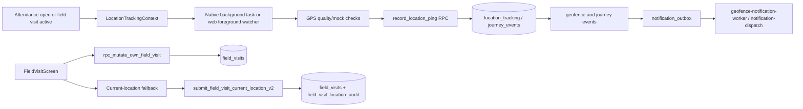

# Location, Geofence and Field-Visit Audit

## Evidence scope

This pass inspected `contexts/LocationTrackingContext.tsx`, `services/location/attendanceTrackingLifecycle.ts`, `services/location/backgroundLocationTask.ts`, `services/location/offlineSync.ts`, `services/field-visit.service.ts`, `services/current-location-visit.service.ts`, `screens/FieldVisitScreen.tsx`, the field-visit Edge Functions, and the location/field-visit migrations through `20260723000000_attendance_background_location.sql` and `20260722000000_same_visit_mismatch_checkin.sql`.

## Verified workflow

## Location tracking

- `LocationTrackingContext` restores/rechecks tracking on app-state changes, realtime attendance/field-visit updates, and a two-minute timer. It explicitly reports that continuous/background tracking is unavailable on web; reliable locked-screen tracking requires the Android native bridge.
- `backgroundLocationTask.ts` registers `hrms-attendance-location-v2`; it stores native configuration in secure storage, uses approximately two-minute office intervals and approximately one-minute field-visit intervals while moving/quality permits, and stops when no open attendance/visit exists, the server closes attendance, or the session is older than 16 hours.
- `offlineSync.ts` drains queued pings in GPS-time order through `record_location_ping`, distinguishing retryable and permanent errors. Database migration `20260723000000_attendance_background_location.sql` intentionally provides no direct insert policy for `location_tracking` or `journey_events`; server RPC is the write boundary.

## Field visit operations

`FieldVisitService.createVisit` validates destination coordinates, derives an origin from the last location ping or attendance check-in, and calls `rpc_mutate_own_field_visit(CREATE)`. `checkIn`, selected-site check-in, `checkOut`, and `markMissed` call server mutations and reject responses unless the expected id/status/timestamp is returned. The UI renders `PENDING`, `IN_TRANSIT`, `CHECKED_IN`, `COMPLETED`, and `MISSED` states and offers navigation and meeting notes (`screens/FieldVisitScreen.tsx`).

The selected-site path calls `check_in_field_visit_at_selected_site`; the SQL function computes distance server-side. Current-location submissions use `submit_field_visit_current_location`/`_v2`, carry an idempotency key, declaration, mismatch reason and optional photo, and create an auditable child row linked by `source_field_visit_id`. `collapseCurrentLocationSubmissions` prevents the employee UI from counting the source and verification child as two visits.

## Evidence and review

The `field-visit-evidence` bucket, path ownership checks, image type/size checks, offline integrity hash and immutable location audit are defined in `20260720000000_current_location_fallback.sql` and later replacement migrations. `field-visit-evidence-upload/index.ts` is the service endpoint for upload; the client requires an authenticated, refreshable session before submission. Reviewer RPC `review_field_visit_current_location` writes status, reviewer and notes and generates a notification. Do not treat a `PENDING` verification label as an approved visit.

## Geofence and journey notifications

`record_location_ping` updates journey state and emits events for office/visit context. `geofence-notification-worker` consumes `notification_outbox` rows; `notification-dispatch` consumes push outbox/delivery rows with idempotent delivery logging. `send-journey-notifications` authenticates a webhook secret before reading journey events and generates deep links. These are background integrations; delivery is not proof that a GPS ping was stored unless the corresponding database row exists.

## Classification and risks

| ID | Finding | Classification | Evidence |
|---|---|---|---|
| LT-01 | Android/native background tracking is implemented; web tracking is foreground-only. | VERIFIED | `LocationTrackingContext.tsx`, `backgroundLocationTask.ts` |
| LT-02 | Location writes are server-mediated through `record_location_ping`; no direct table insert policy is defined in the inspected migration. | VERIFIED | `20260723000000_attendance_background_location.sql` |
| LT-03 | Field-visit CRUD and state confirmation are implemented through RPCs. | VERIFIED | `services/field-visit.service.ts` |
| LT-04 | Current-location fallback is a separate reviewable child submission, not silent replacement. | VERIFIED | `current-location-visit.service.ts`, `submit_field_visit_current_location_v2` |
| LT-05 | Evidence upload/review depends on deployed storage policies, Edge Function configuration and latest replacement migration. | PARTIALLY IMPLEMENTED | field-visit evidence migrations/functions; deployment not executed |
| LT-06 | Notification delivery is asynchronous and best-effort; queue/delivery records must be checked for operational confirmation. | VERIFIED | `notification-dispatch`, `geofence-notification-worker` |
| LT-07 | Actual background behavior, battery impact and platform permission outcomes require Android device verification. | UNVERIFIED | Native bridge/device tests not executed in this audit |

