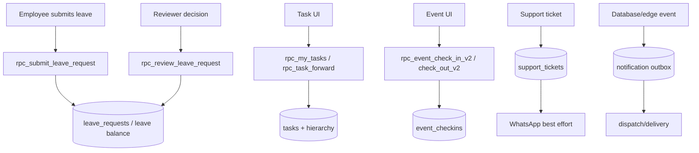

# Leave, Tasks, Notifications, Events and Support Audit

## Leave

`LeaveService.submitLeave` calls `rpc_submit_leave_request` with leave type, date range, reason, half-day flag and period. Employee history is read from `leave_requests`; balances from `leave_balance`; holidays and weekly offs from `holiday_calendar` and `weekly_off_rules`. Cancellation uses `rpc_cancel_leave_request`. Review uses `rpc_review_leave_request` with approve/reject and notes. `screens/LeaveScreen.tsx` is the employee operational surface; the admin leave-management screens provide review/reporting surfaces.

**Status: PARTIALLY IMPLEMENTED until deployment verification.** The client/RPC contract is present, but this audit did not connect to a live Supabase project to verify the latest function body, RLS, balance deduction, overlap handling, or approval hierarchy. Operators must treat the RPC response and database status as authoritative.

## Tasks and hierarchy visibility

`TaskService.getPending` is a small dashboard query against `tasks`. The active richer path is `TaskSharingService.getMyTasks`, which calls `rpc_my_tasks` and exposes relation (`ASSIGNED`, `CREATED`, `SHARED`), update/forward flags and reporting metadata. `rpc_task_forward` forwards to direct reports and `rpc_my_direct_reports` supplies the target list. Migration `20261015130000_task_hierarchy_visibility.sql` is the cited contract. UI actions must not infer visibility from a raw `tasks` query; use the RPC result.

**Status: VERIFIED for client wiring; PARTIALLY IMPLEMENTED for policy enforcement until deployed SQL/RLS is confirmed.**

## Notifications

The client unread badge is `NotificationService.getUnreadCount`, a head-count query on `notifications`. Database procedures such as `enqueue_hrms_notification` and field-visit/event workflows create notification rows. `notification-dispatch/index.ts` handles push outbox and delivery rows; `geofence-notification-worker/index.ts` handles geofence outbox; `send-event-notifications/index.ts` and `send-journey-notifications/index.ts` are event/journey channels. Delivery is asynchronous and retryable; a UI toast or queued row is not delivery proof.

## Events (separate attendance workflow)

`EventService` uses `events`, `event_participants`, `event_announcements` and `event_checkins`. Admin creation/deletion use `rpc_admin_create_event`/`rpc_admin_delete_event`; employee acknowledgement uses `rpc_acknowledge_event`; event attendance uses `rpc_event_check_in_v2` and `rpc_event_check_out_v2` with server geofence, arrival status and optional comp-off credit. Event attendance is a dedicated event record and must not be used as ordinary office attendance. This separation is also enforced in the user-supplied correction note and reflected in `services/event.service.ts`.

## Support tickets

`SupportTicketService.createTicket` inserts `support_tickets` directly, then asynchronously sends WhatsApp notifications to active `SYSTEM_ADMIN`, `ADMIN`, `HR` and `HRD` profiles. Status updates are direct table updates; resolved/closed paths notify HR and the requester. Notification failure is deliberately swallowed after a successful ticket write, so the ticket is the source of truth and WhatsApp is best-effort. `screens/RaiseTicketScreen.tsx` is the employee surface; admin ticket screens provide queue management.

## Workflow diagram

## Findings

| ID | Finding | Classification | Evidence |
|---|---|---|---|
| WF-01 | Leave employee submit/cancel/review RPC wiring exists. | VERIFIED | `services/leave.service.ts` |
| WF-02 | Leave balance, overlap, date-window and approval rules require live SQL verification. | UNVERIFIED | migrations/RPC deployment not executed |
| WF-03 | Hierarchical task visibility and forwarding are RPC-based. | VERIFIED | `services/task-sharing.service.ts`, `20261015130000_task_hierarchy_visibility.sql` |
| WF-04 | Notification delivery is asynchronous with retry/outbox paths. | VERIFIED | notification Edge Functions |
| WF-05 | Event attendance is separate from ordinary attendance. | VERIFIED | `services/event.service.ts`, event RPC names |
| WF-06 | Support tickets persist before WhatsApp notifications and notification failures do not fail the ticket. | VERIFIED | `services/support-ticket.service.ts` |

