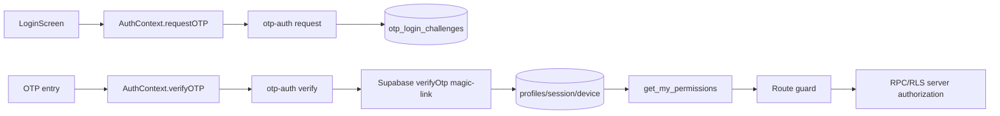
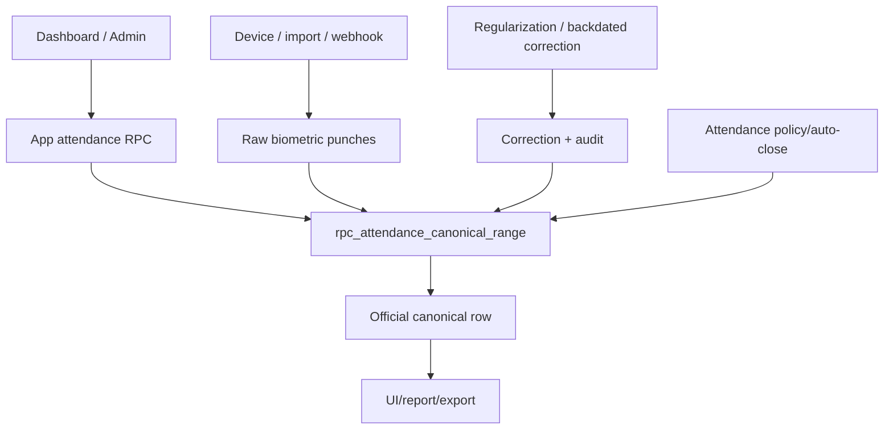
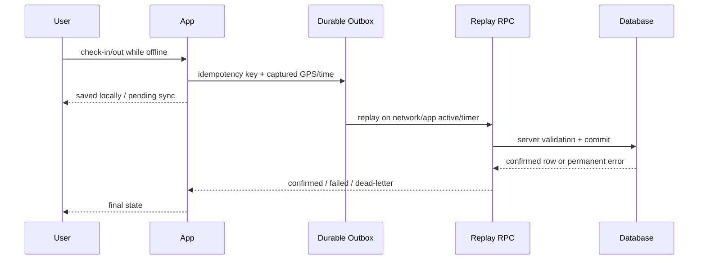
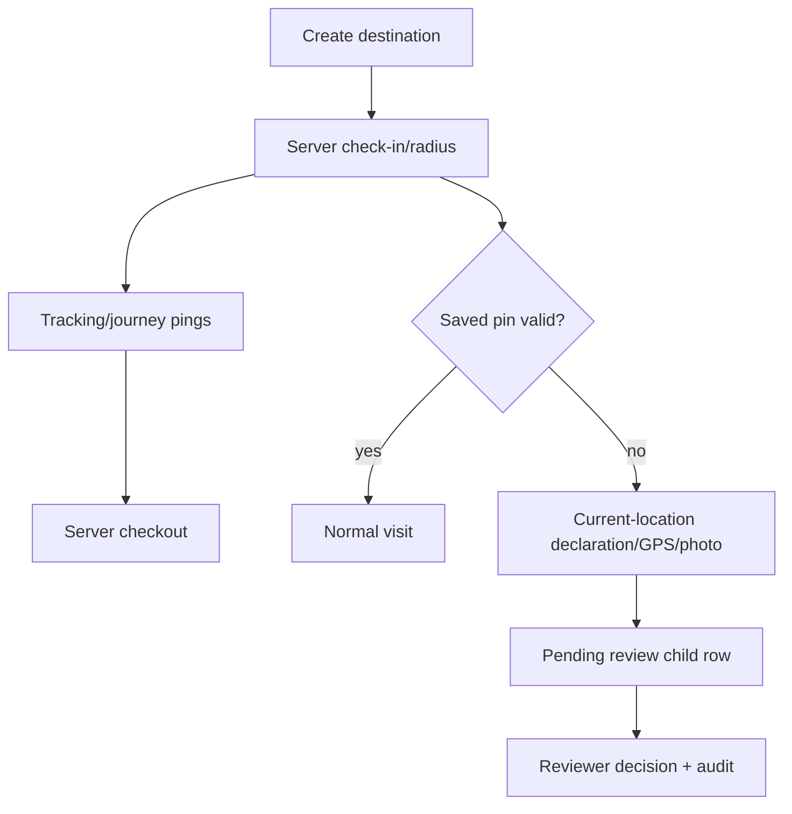
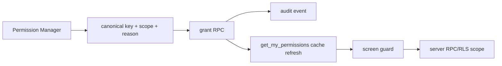
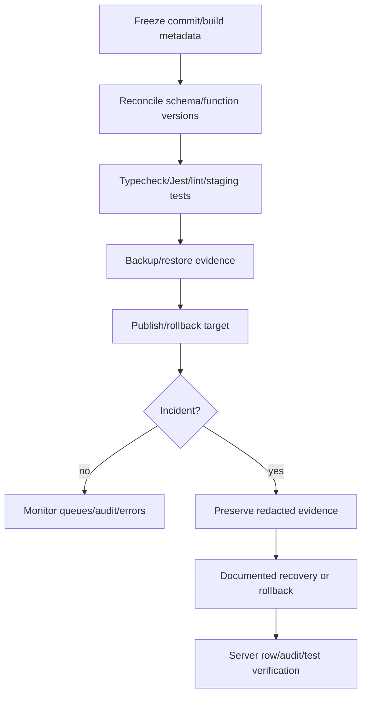

# Workflow Diagrams

## Authentication and authorization

## Attendance source reconciliation

## Offline write

## Field visit and evidence review

## Permission grant

## Release and incident recovery

